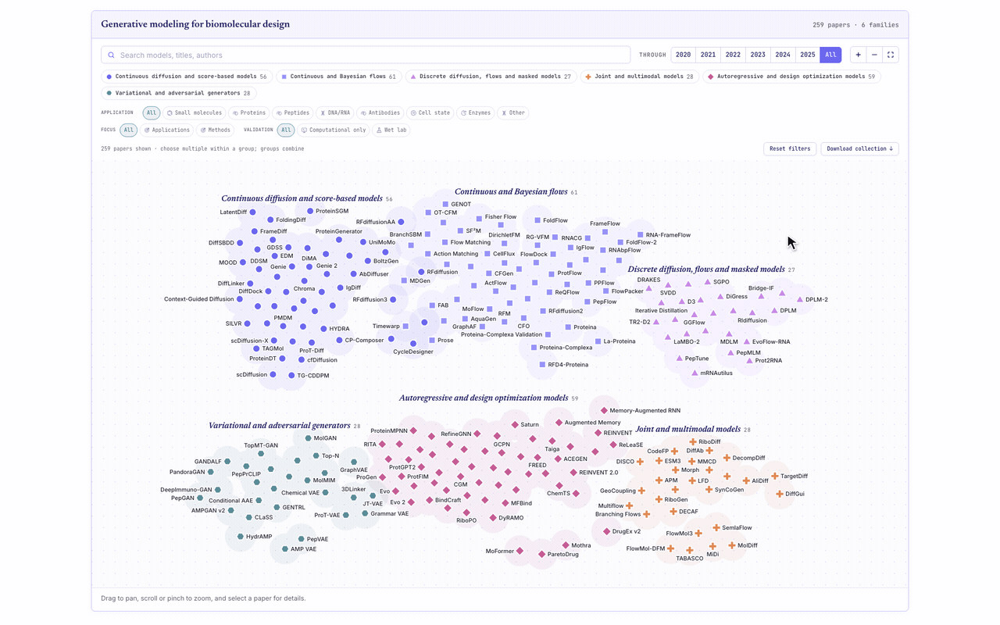

<div align="center">

# Awesome Generative Biomolecular Design

**The paper collection for our survey, *Probing the Biomolecular Design Space with Generative Modeling*.**

[](https://awesome.re)

[](https://doi.org/10.1016/j.sbi.2026.103428)
[](https://generative-biomolecular-design.github.io/)
[](https://generative-biomolecular-design.github.io/map/)

<a href="https://sophtang.github.io/">Sophia Tang</a> &emsp; <a href="https://www.linkedin.com/in/yinuozhang98/">Yinuo Zhang</a> &emsp; <a href="https://www.chatterjeelab.com/">Pranam Chatterjee</a>

<sub><a href="mailto:sophtang@engineering.upenn.edu">sophtang@engineering.upenn.edu</a> &emsp; <a href="mailto:pranam@engineering.upenn.edu">pranam@engineering.upenn.edu</a></sub>

University of Pennsylvania

<!-- GitHub only plays README videos hosted at github.com/user-attachments. For a video player, drag assets/paper_map_demo.mp4 into GitHub's web editor and set MAP_VIDEO_URL in scripts/build_readme.py to the URL it gives you. -->
<a href="assets/paper_map_demo.mp4"></a>

<sub>A tour of our <a href="https://generative-biomolecular-design.github.io/map/">interactive paper map</a>.</sub>

[News](#news) · [Abstract](#abstract) · [Start here](#-start-here) · [Recently added](#-recently-added) · [More papers](#-more-papers) · [Contributing](#contributing) · [BibTeX](#bibtex) · [Star History](#star-history)

</div>

## News

- **Nov 10, 2026**: Our survey is published in [Current Opinion in Structural Biology](https://doi.org/10.1016/j.sbi.2026.103428).
- **Nov 10, 2026**: Our [Map of Generative Modeling for Biomolecular Design](https://generative-biomolecular-design.github.io/map/) and [paper list](https://github.com/sophtang/Awesome-Generative-Biomolecular-Design) are live.

## Abstract

Discovering new-to-nature biomolecules requires navigating a design space that has only been sparsely explored. Traditional paradigms such as rational design, directed evolution, and high-throughput screening have driven many successful functional biomolecules, but are significantly limited when given an unseen target or novel function, where there is no starting point for design. Generative modeling offers a way to approximate the continuous manifold underlying observed biological data, enabling the sampling of new candidates beyond any finite dataset while remaining within the support of viable, functional biomolecules. Here, we outline recent progress in generative biomolecular design through an algorithmic lens, bridging theoretical foundations to its extensions and applications in truly *de novo* and *controllable* biomolecular design.

## 🌟 Start here

These are the representative models from the model table in our survey. The table connects base generators to their control mechanisms and design objectives across small molecules, mRNA, peptides, and proteins, following the survey's algorithmic perspective on *de novo* and controllable biomolecular design.

| Paper | Links | Venue | State space / Base generator | Control / Intervention | Design task / Objective |
|:--|:--|:--|:--|:--|:--|
| <b>RFdiffusion</b><br>De novo design of protein structure and function with RFdiffusion | <a href="https://www.nature.com/articles/s41586-023-06415-8">Paper</a> · <a href="https://github.com/RosettaCommons/RFdiffusion"></a> | Nature 2023 | Continuous frames; diffusion | Conditional generation; inference | Protein backbones, binders, motifs, symmetric assemblies |
| <b>FrameDiff</b><br>SE(3) diffusion model with application to protein backbone generation | <a href="https://proceedings.mlr.press/v202/yim23a.html">Paper</a> · <a href="https://arxiv.org/abs/2302.02277">arXiv</a> · <a href="https://www.alphaxiv.org/abs/2302.02277">alphaXiv</a> · <a href="https://github.com/jasonkyuyim/se3_diffusion"></a> | ICML 2023 | Continuous frames; diffusion | Unconditional sampling; inference | Designable protein backbones |
| <b>AlphaFlow</b><br>AlphaFold meets flow matching for generating protein ensembles | <a href="https://proceedings.mlr.press/v235/jing24a.html">Paper</a> · <a href="https://arxiv.org/abs/2402.04845">arXiv</a> · <a href="https://www.alphaxiv.org/abs/2402.04845">alphaXiv</a> · <a href="https://github.com/bjing2016/alphaflow"></a> | ICML 2024 | Continuous coordinates; flow matching | Sequence-conditioned sampling; inference | Protein conformational ensembles |
| <b>FoldFlow</b><br>SE(3)-stochastic flow matching for protein backbone generation | <a href="https://openreview.net/forum?id=kJFIH23hXb">Paper</a> · <a href="https://arxiv.org/abs/2310.02391">arXiv</a> · <a href="https://www.alphaxiv.org/abs/2310.02391">alphaXiv</a> · <a href="https://github.com/DreamFold/FoldFlow"></a> | ICLR 2024 | Continuous frames; flow matching | Unconditional sampling; inference | Designable protein backbones |
| <b>FrameFlow</b><br>Fast protein backbone generation with SE(3) flow matching | <a href="https://arxiv.org/abs/2310.05297">arXiv</a> · <a href="https://www.alphaxiv.org/abs/2310.05297">alphaXiv</a> · <a href="https://github.com/microsoft/protein-frame-flow"></a> | arXiv 2023 | Continuous frames; flow matching | Unconditional sampling; inference (2023 version) | Protein backbone generation |
| <b>La-Proteina</b><br>La-Proteina: Atomistic protein generation via partially latent flow matching | <a href="https://openreview.net/forum?id=RDerF20JYT">Paper</a> · <a href="https://arxiv.org/abs/2507.09466">arXiv</a> · <a href="https://www.alphaxiv.org/abs/2507.09466">alphaXiv</a> · <a href="https://github.com/NVIDIA-BioNeMo/la-proteina"></a> | ICLR 2026 | Continuous frames and latent variables; flow matching | Conditional or unconditional sampling; inference | Joint sequence and atomistic protein structure |
| <b>D-Flow</b><br>D-Flow: Multi-modality flow matching for D-peptide design | <a href="https://doi.org/10.1109/JBHI.2026.3683934">Paper</a> · <a href="https://arxiv.org/abs/2411.10618">arXiv</a> · <a href="https://www.alphaxiv.org/abs/2411.10618">alphaXiv</a> · <a href="https://github.com/smiles724/PeptideDesign"></a> | IEEE J. Biomed. Health Inform. 2026 | Multimodal geometry and residue identities; flow matching | Receptor-conditioned generation; inference | D-peptide structure and sequence design |
| <b>PepFlow</b><br>Full-atom peptide design based on multi-modal flow matching | <a href="https://proceedings.mlr.press/v235/li24o.html">Paper</a> · <a href="https://arxiv.org/abs/2406.00735">arXiv</a> · <a href="https://www.alphaxiv.org/abs/2406.00735">alphaXiv</a> · <a href="https://github.com/Ced3-han/PepFlowww"></a> | ICML 2024 | Continuous frames, torsions and simplex variables; flow matching | Receptor-conditioned generation; inference | All-atom peptide co-design |
| <b>IgFlow</b><br>IgFlow: flow matching for de novo antibody design | <a href="https://www.mlsb.io/papers_2024/IgFlow%3A_Flow_Matching_for_De_Novo_Antibody_Design.pdf">Paper</a> | NeurIPS MLSB Workshop 2024 (preprint) | Continuous frames; optional discrete sequence flow | Conditional or unconditional sampling; inference | Antibody variable domains and CDR design |
| <b>RG-VFM</b><br>Riemannian Variational Flow Matching for Material and Protein Design | <a href="https://www.ideal-machine-intelligence.eu/pdfs/zaghen2026riemannian.pdf">Paper</a> · <a href="https://arxiv.org/abs/2502.12981">arXiv</a> · <a href="https://www.alphaxiv.org/abs/2502.12981">alphaXiv</a> · <a href="https://github.com/olgatticus/rg-vfm"></a> | ICLR 2026 | Continuous manifolds; variational flow matching | Unconditional sampling; inference | Materials and protein backbone generation |
| <b>RNAFlow</b><br>RNAFlow: RNA structure &amp; sequence design via inverse folding-based flow matching | <a href="https://proceedings.mlr.press/v235/nori24a.html">Paper</a> · <a href="https://arxiv.org/abs/2405.18768">arXiv</a> · <a href="https://www.alphaxiv.org/abs/2405.18768">alphaXiv</a> · <a href="https://github.com/divnori/rnaflow"></a> | ICML 2024 | Continuous structure flow with sequence inverse folding | Protein-conditioned generation; inference | RNA sequence–structure co-design |
| <b>FlowDesign</b><br>FlowDesign: Improved design of antibody CDRs through flow matching and better prior distributions | <a href="https://www.sciencedirect.com/science/article/pii/S2405471225001036">Paper</a> · <a href="https://github.com/nohandsomewujun/FlowDesign"></a> | Cell Syst. 2025 | Sequence and continuous geometry; flow matching | Antigen-conditioned generation; inference | Antibody CDR sequence–structure design |
| <b>SGPO</b><br>Steering generative models with experimental data for protein fitness optimization | <a href="https://openreview.net/forum?id=Ice2BHIumz">Paper</a> · <a href="https://arxiv.org/abs/2505.15093">arXiv</a> · <a href="https://www.alphaxiv.org/abs/2505.15093">alphaXiv</a> · <a href="https://github.com/jsunn-y/SGPO"></a> | NeurIPS 2025 | Discrete diffusion; continuous and autoregressive variants compared | Classifier/posterior guidance; inference and simulated adaptive selection | Protein fitness optimization |
| <b>DPLM family</b><br>Diffusion language models are versatile protein learners<br>DPLM-2: A Multimodal Diffusion Protein Language Model<br>Elucidating the Design Space of Multimodal Protein Language Models | <b>DPLM</b>: <a href="https://proceedings.mlr.press/v235/wang24ct.html">Paper</a> · <a href="https://arxiv.org/abs/2402.18567">arXiv</a> · <a href="https://www.alphaxiv.org/abs/2402.18567">alphaXiv</a> · <a href="https://github.com/bytedance/dplm"></a><br><b>DPLM-2</b>: <a href="https://proceedings.iclr.cc/paper_files/paper/2025/hash/57c30b677add9aa78e1745f0643104d0-Abstract-Conference.html">Paper</a> · <a href="https://arxiv.org/abs/2410.13782">arXiv</a> · <a href="https://www.alphaxiv.org/abs/2410.13782">alphaXiv</a> · <a href="https://github.com/bytedance/dplm"></a><br><b>DPLM-2.1</b>: <a href="https://proceedings.mlr.press/v267/hsieh25a.html">Paper</a> · <a href="https://arxiv.org/abs/2504.11454">arXiv</a> · <a href="https://www.alphaxiv.org/abs/2504.11454">alphaXiv</a> · <a href="https://github.com/bytedance/dplm"></a> | ICML 2024<br>ICLR 2025<br>ICML 2025 | Discrete token diffusion; sequence and structure tokens vary by version | Conditioning and optional guidance; inference | Protein sequence generation and multimodal co-design |
| <b>LaMBO-2</b><br>Protein design with guided discrete diffusion | <a href="https://proceedings.neurips.cc/paper_files/paper/2023/file/29591f355702c3f4436991335784b503-Paper-Conference.pdf">Paper</a> · <a href="https://arxiv.org/abs/2305.20009">arXiv</a> · <a href="https://www.alphaxiv.org/abs/2305.20009">alphaXiv</a> · <a href="https://github.com/ngruver/NOS"></a> | NeurIPS 2023 | Discrete sequence diffusion; continuous hidden-state guidance | Gradient guidance and Bayesian selection; inference plus experimental feedback | Antibody expression and binding under edit constraints |
| <b>DRAKES</b><br>Fine-tuning discrete diffusion models via reward optimization with applications to DNA and protein design | <a href="https://proceedings.iclr.cc/paper_files/paper/2025/file/771e09dd204ea339da0d8114c48afd21-Paper-Conference.pdf">Paper</a> · <a href="https://arxiv.org/abs/2410.13643">arXiv</a> · <a href="https://www.alphaxiv.org/abs/2410.13643">alphaXiv</a> · <a href="https://github.com/ChenyuWang-Monica/DRAKES"></a> | ICLR 2025 | Discrete diffusion | Reward fine-tuning; parameter updates before sampling | DNA enhancer activity; protein stability |
| <b>PepTune</b><br>PepTune: De novo generation of therapeutic peptides with multi-objective-guided discrete diffusion | <a href="https://proceedings.mlr.press/v267/tang25n.html">Paper</a> · <a href="https://arxiv.org/abs/2412.17780">arXiv</a> · <a href="https://www.alphaxiv.org/abs/2412.17780">alphaXiv</a> · <a href="https://huggingface.co/ChatterjeeLab/PepTune">Code</a> | ICML 2025 | Discrete masked diffusion of SMILES | Multi-objective tree guidance; inference | Peptide affinity, permeability, solubility and safety proxies |
| <b>TR2-D2</b><br>TR2-D2: Tree Search Guided Trajectory-Aware Fine-Tuning for Discrete Diffusion | <a href="https://arxiv.org/abs/2509.25171">arXiv</a> · <a href="https://www.alphaxiv.org/abs/2509.25171">alphaXiv</a> · <a href="https://github.com/sophtang/TR2-D2"></a> | arXiv 2025 | Discrete masked diffusion | Tree-search replay and off-policy RL; fine-tuning | DNA activity and multiple peptide properties |
| <b>TD3B</b><br>TD3B: Transition-Directed Discrete Diffusion for Allosteric Binder Generation | <a href="https://arxiv.org/abs/2605.09810">arXiv</a> · <a href="https://www.alphaxiv.org/abs/2605.09810">alphaXiv</a> · <a href="https://huggingface.co/ChatterjeeLab/TD3B">Code</a> | ICML 2026 | Discrete masked diffusion | Direction-aware reward fine-tuning; sampling with selection | Predicted agonist/antagonist peptide binders |
| <b>mRNAutilus (2026)</b><br>mRNAutilus: Multi-Objective-Guided Discrete Generation of mRNA with Optimized Therapeutic Properties | <a href="https://mrna-multi-objective-design.github.io/">Paper</a> · <a href="https://arxiv.org/abs/2605.31296">arXiv</a> · <a href="https://www.alphaxiv.org/abs/2605.31296">alphaXiv</a> · <a href="https://huggingface.co/atombio/mrnautilus">Code</a> | arXiv 2026 | Discrete masked diffusion | Multi-objective Monte Carlo Tree Guidance; inference | Full-length mRNA: half-life, translation efficiency and protein abundance |
| <b>GenMol</b><br>GenMol: A Drug Discovery Generalist with Discrete Diffusion | <a href="https://proceedings.mlr.press/v267/lee25o.html">Paper</a> · <a href="https://arxiv.org/abs/2501.06158">arXiv</a> · <a href="https://www.alphaxiv.org/abs/2501.06158">alphaXiv</a> · <a href="https://github.com/NVIDIA-BioNeMo/genmol"></a> | ICML 2025 | Discrete masked diffusion of SAFE strings | Fragment constraints and goal-directed selection; inference | Small-molecule generation and property optimization |
| <b>DiGress</b><br>DiGress: Discrete denoising diffusion for graph generation | <a href="https://arxiv.org/abs/2209.14734">arXiv</a> · <a href="https://www.alphaxiv.org/abs/2209.14734">alphaXiv</a> · <a href="https://github.com/cvignac/DiGress"></a> | ICLR 2023 | Discrete graph diffusion | Unconditional or property-guided sampling; inference | Molecular graph generation |
| <b>D3 (2024)</b><br>Designing DNA With Tunable Regulatory Activity Using Score-Entropy Discrete Diffusion | <a href="https://www.biorxiv.org/content/10.1101/2024.05.23.595630v1">Paper</a> | bioRxiv 2024 | Discrete sequence diffusion | Regulatory guidance; inference | DNA regulatory activity |
| <b>MOG-DFM</b><br>Multi-objective-guided discrete flow matching for controllable biological sequence design | <a href="https://arxiv.org/abs/2505.07086">arXiv</a> · <a href="https://www.alphaxiv.org/abs/2505.07086">alphaXiv</a> · <a href="https://huggingface.co/ChatterjeeLab/MOG-DFM">Code</a> | arXiv 2025 | Discrete sequences; CTMC flow matching | Multi-objective transition guidance; inference | Peptide properties and DNA activity |
| <b>Bridge-IF</b><br>Bridge-IF: Learning Inverse Protein Folding with Markov Bridges | <a href="https://proceedings.neurips.cc/paper_files/paper/2024/file/466a8a8ae45c488b2bd312699ba1e5ee-Paper-Conference.pdf">Paper</a> · <a href="https://arxiv.org/abs/2411.02120">arXiv</a> · <a href="https://www.alphaxiv.org/abs/2411.02120">alphaXiv</a> · <a href="https://github.com/violet-sto/Bridge-IF"></a> | NeurIPS 2024 | Discrete sequences; Markov-bridge flow | Structure-conditioned generation; inference | Protein inverse folding |
| <b>DirichletFM</b><br>Dirichlet flow matching with applications to DNA sequence design | <a href="https://arxiv.org/abs/2402.05841">arXiv</a> · <a href="https://www.alphaxiv.org/abs/2402.05841">alphaXiv</a> · <a href="https://github.com/HannesStark/dirichlet-flow-matching"></a> | ICML 2024 | Continuous simplex relaxation; flow matching | Classifier or classifier-free guidance; inference | DNA regulatory sequence generation |
| <b>Fisher Flow</b><br>Fisher flow matching for generative modeling over discrete data | <a href="https://proceedings.neurips.cc/paper_files/paper/2024/file/fadec8f2e65f181d777507d1df69b92f-Paper-Conference.pdf">Paper</a> · <a href="https://arxiv.org/abs/2405.14664">arXiv</a> · <a href="https://www.alphaxiv.org/abs/2405.14664">alphaXiv</a> · <a href="https://github.com/olsdavis/fisher-flow"></a> | NeurIPS 2024 | Continuous simplex geometry; flow matching | Task-specific sampling; inference | DNA and molecular sequence generation |
| <b>dWJS</b><br>Protein discovery with discrete walk-jump sampling | <a href="https://openreview.net/forum?id=zMPHKOmQNb">Paper</a> · <a href="https://arxiv.org/abs/2306.12360">arXiv</a> · <a href="https://www.alphaxiv.org/abs/2306.12360">alphaXiv</a> · <a href="https://github.com/prescient-design/walk-jump"></a> | ICLR 2024 | Continuous smoothed sequences; Langevin walk and discrete denoising jump | Conditional training/sequence constraints; sampling and selection | Antibody expression and binding |
| <b>FlowMol3</b><br>FlowMol3: flow matching for 3D de novo small-molecule generation | <a href="https://pubs.rsc.org/en/content/articlelanding/2026/dd/d5dd00363f">Paper</a> · <a href="https://arxiv.org/abs/2508.12629">arXiv</a> · <a href="https://www.alphaxiv.org/abs/2508.12629">alphaXiv</a> · <a href="https://github.com/Dunni3/FlowMol"></a> | Digital Discov. 2026 | Continuous coordinates and discrete atom/bond states; joint flow matching | Unconditional sampling; inference | All-atom small-molecule generation |
| <b>Multiflow</b><br>Generative flows on discrete state-spaces: Enabling multimodal flows with applications to protein co-design | <a href="https://proceedings.mlr.press/v235/campbell24a.html">Paper</a> · <a href="https://arxiv.org/abs/2402.04997">arXiv</a> · <a href="https://www.alphaxiv.org/abs/2402.04997">alphaXiv</a> · <a href="https://github.com/jasonkyuyim/multiflow"></a> | ICML 2024 | Continuous frames and discrete sequence CTMC; joint flow matching | Conditional or unconditional sampling; inference | Protein co-design, folding and inverse folding |
| <b>ESM3</b><br>Simulating 500 million years of evolution with a language model | <a href="https://doi.org/10.1126/science.ads0018">Paper</a> · <a href="https://github.com/Biohub/esm"></a> | Science 2025 | Discrete multimodal tokens; iterative masked generation | Prompt conditioning and iterative selection; inference | Protein sequence/structure/function generation |
| <b>DiffAb</b><br>Antigen-specific antibody design and optimization with diffusion-based generative models for protein structures | <a href="https://www.biorxiv.org/content/10.1101/2022.07.10.499510v5">Paper</a> · <a href="https://github.com/luost26/diffab"></a> | NeurIPS 2022 | Continuous frames and discrete residue types; diffusion | Antigen-conditioned generation; inference | Antibody CDR sequence–structure co-design |

Validation belongs to the cited study and version. Computational benchmarks and experimental assay outcomes are different forms of evidence; results across tasks are not a ranking of model families. The accompanying [paper metadata](data/papers.json) preserves the map's validation labels, source links, and Table 2 details. The original FrameFlow study and its later motif-scaffolding extension remain separate papers.

## 🆕 Recently added

New papers added after 2026-11-06 will appear here. All papers remain listed in their categories below.

| Added | Paper | Links | Family |
|:--|:--|:--|:--|
| | No new papers yet. | | |

## 📚 More papers

These are the remaining 225 papers, grouped by model family and listed newest year first, then alphabetically. Click a family to open its table.

<details>
<summary><b>🌊 Continuous diffusion and score-based models</b> (53 papers)</summary>
<br>

| Year | Paper | Links | Venue | Application |
|:--|:--|:--|:--|:--|
| 2026 | <b>scDiffusion-X</b>: A multi-modal diffusion model with dual-cross-attention for multi-omics data generation and translation | <a href="https://www.nature.com/articles/s41467-026-71744-x">Paper</a> · <a href="https://github.com/EperLuo/scDiffusion-X"></a> | Nat. Commun. 2026 | Cell state, Multi-omics |
| 2026 | Atomic functional site scaffolding in biopolymers with <b>RFdiffusion3</b> | <a href="https://doi.org/10.1126/science.aeh2982">Paper</a> · <a href="https://github.com/RosettaCommons/foundry"></a> | Science 2026 | Proteins, Small molecules, DNA/RNA, Enzymes, DNA |
| 2026 | Designing synthetic regulatory elements using the generative AI framework <b>DNA-Diffusion</b> | <a href="https://www.nature.com/articles/s41588-025-02441-6">Paper</a> · <a href="https://github.com/pinellolab/DNA-Diffusion"></a> | Nat. Genet. 2026 | DNA, DNA/RNA |
| 2026 | <b>AnewOmni</b>: Programming Biomolecular Interactions with All-Atom Generative Model | <a href="https://www.biorxiv.org/content/10.64898/2026.03.12.711044v3.abstract">Paper</a> · <a href="https://github.com/bytedance/AnewOmni"></a> | bioRxiv 2026 | Proteins, Peptides, Antibodies, Small molecules |
| 2025 | <b>ProteinDT</b>: A text-guided protein design framework | <a href="https://www.nature.com/articles/s42256-025-01011-z">Paper</a> · <a href="https://arxiv.org/abs/2302.04611">arXiv</a> · <a href="https://www.alphaxiv.org/abs/2302.04611">alphaXiv</a> · <a href="https://github.com/chao1224/ProteinDT"></a> | Nat. Mach. Intell. 2025 | Proteins, Peptides |
| 2025 | <b>RFpeptides</b>: Accurate de novo design of high-affinity protein-binding macrocycles using deep learning | <a href="https://www.nature.com/articles/s41589-025-01929-w">Paper</a> | Nat. Chem. Biol. 2025 | Peptides |
| 2025 | <b>AGDIFF</b>: Attention-Enhanced Diffusion for Molecular Geometry Prediction | <a href="https://doi.org/10.1021/acs.jcim.4c01896">Paper</a> · <a href="https://github.com/ADicksonLab/AGDIFF"></a> | J. Chem. Inf. Model. 2025 | Small molecules |
| 2025 | <b>RFantibody</b>: Atomically accurate de novo design of antibodies with RFdiffusion | <a href="https://www.nature.com/articles/s41586-025-09721-5">Paper</a> · <a href="https://github.com/RosettaCommons/RFantibody"></a> | Nature 2025 | Proteins, Antibodies |
| 2025 | <b>BoltzGen</b>: Toward Universal Binder Design | <a href="https://www.biorxiv.org/content/10.1101/2025.11.20.689494">Paper</a> · <a href="https://github.com/HannesStark/boltzgen"></a> | bioRxiv 2025 | Proteins, Peptides, Antibodies, Small molecules, DNA/RNA, DNA |
| 2025 | <b>cfDiffusion</b>: diffusion-based efficient generation of high quality scRNA-seq data with classifier-free guidance | <a href="https://academic.oup.com/bib/article/26/1/bbaf071/8030540">Paper</a> · <a href="https://github.com/SuperheroBetter/cfDiffusion"></a> | Brief. Bioinform. 2025 | Cell state |
| 2025 | <b>ScoreMD</b>: Consistent Sampling and Simulation: Molecular Dynamics with Energy-Based Diffusion Models | <a href="https://arxiv.org/abs/2506.17139">arXiv</a> · <a href="https://www.alphaxiv.org/abs/2506.17139">alphaXiv</a> · <a href="https://github.com/noegroup/ScoreMD"></a> | NeurIPS 2025 | Peptides, Proteins |
| 2025 | <b>DiMA</b>: Diffusion on Language Model Encodings for Protein Sequence Generation | <a href="https://proceedings.mlr.press/v267/meshchaninov25a.html">Paper</a> · <a href="https://arxiv.org/abs/2403.03726">arXiv</a> · <a href="https://www.alphaxiv.org/abs/2403.03726">alphaXiv</a> · <a href="https://github.com/MeshchaninovViacheslav/DiMA"></a> | ICML 2025 | Proteins |
| 2025 | <b>BioEmu</b>: Scalable emulation of protein equilibrium ensembles with generative deep learning | <a href="https://doi.org/10.1126/science.adv9817">Paper</a> · <a href="https://github.com/microsoft/bioemu"></a> | Science 2025 | Proteins |
| 2025 | <b>TG-CDDPM</b>: text-guided antimicrobial peptides generation based on conditional denoising diffusion probabilistic model | <a href="https://doi.org/10.1093/bib/bbae644">Paper</a> | Brief. Bioinform. 2025 | Peptides |
| 2025 | <b>SuperDiff</b>: The Superposition of Diffusion Models Using the Itô Density Estimator | <a href="https://arxiv.org/abs/2412.17762">arXiv</a> · <a href="https://www.alphaxiv.org/abs/2412.17762">alphaXiv</a> · <a href="https://github.com/necludov/super-diffusion"></a> | ICLR 2025 | Proteins |
| 2025 | <b>UniMoMo</b>: Unified Generative Modeling of 3D Molecules for De Novo Binder Design | <a href="https://proceedings.mlr.press/v267/kong25b.html">Paper</a> · <a href="https://arxiv.org/abs/2503.19300">arXiv</a> · <a href="https://www.alphaxiv.org/abs/2503.19300">alphaXiv</a> · <a href="https://github.com/kxz18/UniMoMo"></a> | ICML 2025 | Proteins, Peptides, Antibodies, Small molecules |
| 2025 | <b>CP-Composer</b>: Zero-Shot Cyclic Peptide Design via Composable Geometric Constraints | <a href="https://arxiv.org/abs/2507.04225">arXiv</a> · <a href="https://www.alphaxiv.org/abs/2507.04225">alphaXiv</a> | arXiv 2025 | Peptides |
| 2024 | <b>PMDM</b>: A dual diffusion model enables 3D molecule generation and lead optimization based on target pockets | <a href="https://doi.org/10.1038/s41467-024-46569-1">Paper</a> | Nat. Commun. 2024 | Small molecules |
| 2024 | <b>LatentDiff</b>: A Latent Diffusion Model for Protein Structure Generation | <a href="https://proceedings.mlr.press/v231/fu24a.html">Paper</a> · <a href="https://arxiv.org/abs/2305.04120">arXiv</a> · <a href="https://www.alphaxiv.org/abs/2305.04120">alphaXiv</a> · <a href="https://github.com/divelab/AIRS/tree/main/OpenProt/LatentDiff"></a> | LoG 2024 | Proteins |
| 2024 | <b>Protpardelle</b>: An all-atom protein generative model | <a href="https://doi.org/10.1073/pnas.2311500121">Paper</a> · <a href="https://github.com/ProteinDesignLab/protpardelle"></a> | PNAS 2024 | Proteins |
| 2024 | <b>Context-Guided Diffusion</b> for Out-of-Distribution Molecular and Protein Design | <a href="https://proceedings.mlr.press/v235/klarner24a.html">Paper</a> · <a href="https://arxiv.org/abs/2407.11942">arXiv</a> · <a href="https://www.alphaxiv.org/abs/2407.11942">alphaXiv</a> · <a href="https://github.com/leojklarner/context-guided-diffusion"></a> | ICML 2024 | Proteins, Small molecules, Materials |
| 2024 | <b>CycleDesigner</b>: Leveraging RFdiffusion and HighFold to Design Cyclic Peptide Binders for Specific Targets | <a href="https://doi.org/10.1101/2024.11.27.625581">Paper</a> | bioRxiv 2024 | Peptides |
| 2024 | <b>IgDiff</b>: De Novo Antibody Design with SE(3) Diffusion | <a href="https://doi.org/10.1089/cmb.2024.0768">Paper</a> · <a href="https://arxiv.org/abs/2405.07622">arXiv</a> · <a href="https://www.alphaxiv.org/abs/2405.07622">alphaXiv</a> · <a href="https://github.com/amelie-iska/IgDiff"></a> | J. Comput. Biol. 2024 | Proteins, Antibodies |
| 2024 | <b>PepFlow (conformational sampling)</b>: Direct conformational sampling from peptide energy landscapes through hypernetwork-conditioned diffusion | <a href="https://www.nature.com/articles/s42256-024-00860-4">Paper</a> · <a href="https://gitlab.com/oabdin/pepflow">Code</a> | Nat. Mach. Intell. 2024 | Peptides |
| 2024 | <b>DynamicBind</b>: predicting ligand-specific protein-ligand complex structure with a deep equivariant generative model | <a href="https://www.nature.com/articles/s41467-024-45461-2">Paper</a> · <a href="https://github.com/luwei0917/DynamicBind"></a> | Nat. Commun. 2024 | Small molecules, Proteins |
| 2024 | <b>DiffLinker</b>: Equivariant 3D-conditional diffusion model for molecular linker design | <a href="https://www.nature.com/articles/s42256-024-00815-9">Paper</a> · <a href="https://arxiv.org/abs/2210.05274">arXiv</a> · <a href="https://www.alphaxiv.org/abs/2210.05274">alphaXiv</a> · <a href="https://github.com/igashov/DiffLinker"></a> | Nat. Mach. Intell. 2024 | Small molecules |
| 2024 | <b>PepGLAD</b>: Full-Atom Peptide Design with Geometric Latent Diffusion | <a href="https://papers.nips.cc/paper_files/paper/2024/file/88ad9774ffcb7a272457e9396f793a07-Paper-Conference.pdf">Paper</a> · <a href="https://arxiv.org/abs/2402.13555">arXiv</a> · <a href="https://www.alphaxiv.org/abs/2402.13555">alphaXiv</a> · <a href="https://github.com/THUNLP-MT/PepGLAD"></a> | NeurIPS 2024 | Peptides |
| 2024 | <b>RFdiffusionAA</b>: Generalized biomolecular modeling and design with RoseTTAFold All-Atom | <a href="https://doi.org/10.1126/science.adl2528">Paper</a> · <a href="https://github.com/baker-laboratory/rf_diffusion_all_atom"></a> | Science 2024 | Proteins, Small molecules |
| 2024 | <b>HYDRA</b>: Hybrid Diffusion Model for Stable, Affinity-Driven, Receptor-Aware Peptide Generation | <a href="https://doi.org/10.1021/acs.jcim.4c01020">Paper</a> | J. Chem. Inf. Model. 2024 | Peptides |
| 2024 | Inferring phase transitions and critical exponents from limited observations with <b>thermodynamic maps</b> | <a href="https://doi.org/10.1073/pnas.2321971121">Paper</a> · <a href="https://arxiv.org/abs/2308.14885">arXiv</a> · <a href="https://www.alphaxiv.org/abs/2308.14885">alphaXiv</a> | PNAS 2024 | DNA/RNA, DNA |
| 2024 | <b>ProteinGenerator</b>: Multistate and functional protein design using RoseTTAFold sequence space diffusion | <a href="https://www.nature.com/articles/s41587-024-02395-w">Paper</a> · <a href="https://github.com/RosettaCommons/protein_generator"></a> | Nat. Biotechnol. 2024 | Proteins, Peptides |
| 2024 | Out of Many, One: Designing and Scaffolding Proteins at the Scale of the Structural Universe with <b>Genie 2</b> | <a href="https://arxiv.org/abs/2405.15489">arXiv</a> · <a href="https://www.alphaxiv.org/abs/2405.15489">alphaXiv</a> · <a href="https://github.com/aqlaboratory/genie2"></a> | arXiv 2024 | Proteins |
| 2024 | <b>ProT-Diff</b>: A Modularized and Efficient Strategy for De Novo Generation of Antimicrobial Peptide Sequences by Integrating Protein Language and Diffusion Models | <a href="https://doi.org/10.1002/advs.202406305">Paper</a> · <a href="https://github.com/zswitten/Antimicrobial-Peptides"></a> | Adv. Sci. 2024 | Peptides |
| 2024 | <b>FoldingDiff</b>: Protein structure generation via folding diffusion | <a href="https://www.nature.com/articles/s41467-024-45051-2">Paper</a> · <a href="https://arxiv.org/abs/2209.15611">arXiv</a> · <a href="https://www.alphaxiv.org/abs/2209.15611">alphaXiv</a> · <a href="https://github.com/microsoft/foldingdiff"></a> | Nat. Commun. 2024 | Proteins |
| 2024 | <b>RiboDiffusion</b>: tertiary structure-based RNA inverse folding with generative diffusion models | <a href="https://pmc.ncbi.nlm.nih.gov/articles/PMC11211841/">Paper</a> · <a href="https://arxiv.org/abs/2404.11199">arXiv</a> · <a href="https://www.alphaxiv.org/abs/2404.11199">alphaXiv</a> · <a href="https://github.com/ml4bio/RiboDiffusion"></a> | Bioinformatics 2024 | RNA, DNA/RNA |
| 2024 | <b>scDiffusion</b>: conditional generation of high-quality single-cell data using diffusion model | <a href="https://academic.oup.com/bioinformatics/article/40/9/btae518/7738782">Paper</a> · <a href="https://arxiv.org/abs/2401.03968">arXiv</a> · <a href="https://www.alphaxiv.org/abs/2401.03968">alphaXiv</a> · <a href="https://github.com/EperLuo/scDiffusion"></a> | Bioinformatics 2024 | Cell state |
| 2024 | <b>DiffSBDD</b>: Structure-based drug design with equivariant diffusion models | <a href="https://www.nature.com/articles/s43588-024-00737-x">Paper</a> · <a href="https://arxiv.org/abs/2210.13695">arXiv</a> · <a href="https://www.alphaxiv.org/abs/2210.13695">alphaXiv</a> · <a href="https://github.com/arneschneuing/DiffSBDD"></a> | Nat. Comput. Sci. 2024 | Small molecules |
| 2024 | <b>TAGMol</b>: Target-Aware Gradient-guided Molecule Generation | <a href="https://arxiv.org/abs/2406.01650">arXiv</a> · <a href="https://www.alphaxiv.org/abs/2406.01650">alphaXiv</a> | arXiv 2024 | Small molecules |
| 2023 | <b>AbDiffuser</b>: Full-Atom Generation of in vitro Functioning Antibodies | <a href="https://proceedings.neurips.cc/paper_files/paper/2023/hash/801ec05b0aae9fcd2ef35c168bd538e0-Abstract.html">Paper</a> · <a href="https://arxiv.org/abs/2308.05027">arXiv</a> · <a href="https://www.alphaxiv.org/abs/2308.05027">alphaXiv</a> | NeurIPS 2023 | Proteins, Antibodies |
| 2023 | <b>AMP-Diffusion</b>: Integrating Latent Diffusion with Protein Language Models for Antimicrobial Peptide Generation | <a href="https://openreview.net/forum?id=145TM9VQhx">Paper</a> | OpenReview preprint 2023 | Peptides |
| 2023 | <b>DiffDock</b>: Diffusion Steps, Twists, and Turns for Molecular Docking | <a href="https://arxiv.org/abs/2210.01776">arXiv</a> · <a href="https://www.alphaxiv.org/abs/2210.01776">alphaXiv</a> · <a href="https://github.com/gcorso/DiffDock"></a> | ICLR 2023 | Small molecules |
| 2023 | <b>DDSM</b>: Dirichlet Diffusion Score Model for Biological Sequence Generation | <a href="https://proceedings.mlr.press/v202/avdeyev23a.html">Paper</a> · <a href="https://arxiv.org/abs/2305.10699">arXiv</a> · <a href="https://www.alphaxiv.org/abs/2305.10699">alphaXiv</a> · <a href="https://github.com/jzhoulab/ddsm"></a> | ICML 2023 | DNA, Other modalities, DNA/RNA |
| 2023 | <b>MOOD</b>: Exploring Chemical Space with Score-based Out-of-distribution Generation | <a href="https://proceedings.mlr.press/v202/lee23f.html">Paper</a> · <a href="https://arxiv.org/abs/2206.07632">arXiv</a> · <a href="https://www.alphaxiv.org/abs/2206.07632">alphaXiv</a> · <a href="https://github.com/SeulLee05/MOOD"></a> | ICML 2023 | Small molecules |
| 2023 | <b>FrameDiPT</b>: SE(3) Diffusion Model for Protein Structure Inpainting | <a href="https://doi.org/10.1101/2023.11.21.568057">Paper</a> · <a href="https://github.com/instadeepai/FrameDiPT"></a> | bioRxiv 2023 | Proteins |
| 2023 | <b>Genie</b>: Generating Protein Structures by Equivariantly Diffusing Oriented Residue Clouds | <a href="https://proceedings.mlr.press/v202/lin23a.html">Paper</a> · <a href="https://arxiv.org/abs/2301.12485">arXiv</a> · <a href="https://www.alphaxiv.org/abs/2301.12485">alphaXiv</a> · <a href="https://github.com/aqlaboratory/genie"></a> | ICML 2023 | Proteins |
| 2023 | <b>Chroma</b>: Illuminating protein space with a programmable generative model | <a href="https://www.nature.com/articles/s41586-023-06728-8">Paper</a> · <a href="https://github.com/generatebio/chroma"></a> | Nature 2023 | Proteins |
| 2023 | <b>ProteinSGM</b>: Score-based generative modeling for de novo protein design | <a href="https://www.nature.com/articles/s43588-023-00440-3">Paper</a> · <a href="https://gitlab.com/mjslee0921/proteinsgm">Code</a> | Nat. Comput. Sci. 2023 | Proteins |
| 2023 | <b>SILVR</b>: Guided Diffusion for Molecule Generation | <a href="https://pmc.ncbi.nlm.nih.gov/articles/PMC10565820/">Paper</a> · <a href="https://arxiv.org/abs/2304.10905">arXiv</a> · <a href="https://www.alphaxiv.org/abs/2304.10905">alphaXiv</a> · <a href="https://github.com/meyresearch/SILVR"></a> | J. Chem. Inf. Model. 2023 | Small molecules |
| 2022 | <b>EDM</b>: Equivariant Diffusion for Molecule Generation in 3D | <a href="https://proceedings.mlr.press/v162/hoogeboom22a.html">Paper</a> · <a href="https://arxiv.org/abs/2203.17003">arXiv</a> · <a href="https://www.alphaxiv.org/abs/2203.17003">alphaXiv</a> · <a href="https://github.com/ehoogeboom/e3_diffusion_for_molecules"></a> | ICML 2022 | Small molecules |
| 2022 | <b>GeoDiff</b>: a Geometric Diffusion Model for Molecular Conformation Generation | <a href="https://arxiv.org/abs/2203.02923">arXiv</a> · <a href="https://www.alphaxiv.org/abs/2203.02923">alphaXiv</a> · <a href="https://github.com/MinkaiXu/GeoDiff"></a> | ICLR 2022 | Small molecules |
| 2022 | <b>GDSS</b>: Score-based Generative Modeling of Graphs via the System of Stochastic Differential Equations | <a href="https://proceedings.mlr.press/v162/jo22a.html">Paper</a> · <a href="https://arxiv.org/abs/2202.02514">arXiv</a> · <a href="https://www.alphaxiv.org/abs/2202.02514">alphaXiv</a> · <a href="https://github.com/harryjo97/GDSS"></a> | ICML 2022 | Small molecules, Other modalities |
| 2022 | <b>Torsional Diffusion</b> for Molecular Conformer Generation | <a href="https://arxiv.org/abs/2206.01729">arXiv</a> · <a href="https://www.alphaxiv.org/abs/2206.01729">alphaXiv</a> · <a href="https://github.com/gcorso/torsional-diffusion"></a> | NeurIPS 2022 | Small molecules |
| 2021 | <b>Equivariant EBM / E-SVGD</b>: Learning Equivariant Energy Based Models with Equivariant Stein Variational Gradient Descent | <a href="https://arxiv.org/abs/2106.07832">arXiv</a> · <a href="https://www.alphaxiv.org/abs/2106.07832">alphaXiv</a> | NeurIPS 2021 | Small molecules |

</details>

<details>
<summary><b>🌀 Continuous and Bayesian flows</b> (49 papers)</summary>
<br>

| Year | Paper | Links | Venue | Application |
|:--|:--|:--|:--|:--|
| 2026 | <b>RFM</b>: A Unified Density Operator View of Flow Control and Merging | <a href="https://arxiv.org/abs/2602.08012">arXiv</a> · <a href="https://www.alphaxiv.org/abs/2602.08012">alphaXiv</a> | ICML 2026 | Small molecules |
| 2026 | <b>ActFlow</b>: Active Flow Expansion for Out-of-Distribution Discovery: from Theory to Molecules | <a href="https://arxiv.org/abs/2606.08802">arXiv</a> · <a href="https://www.alphaxiv.org/abs/2606.08802">alphaXiv</a> | arXiv 2026 | Small molecules, Peptides, Proteins |
| 2026 | <b>AquaGen</b>: Scaling generative models to molecular dynamics precision on thousands of atoms | <a href="https://arxiv.org/abs/2607.03513">arXiv</a> · <a href="https://www.alphaxiv.org/abs/2607.03513">alphaXiv</a> | arXiv 2026 | Small molecules |
| 2026 | Biomolecular design through latent reasoning with <b>RFD4-Proteina</b> | <a href="https://rfd4-proteina.org/assets/paper/RFD4-Proteina.pdf">Paper</a> · <a href="https://github.com/RosettaCommons/RFD4-Proteina"></a> | Preprint 2026 | Proteins, Peptides, Antibodies, Small molecules, DNA/RNA, Carbohydrates, DNA |
| 2026 | <b>BranchSBM</b>: Branched Schrödinger Bridge Matching | <a href="https://arxiv.org/abs/2506.09007">arXiv</a> · <a href="https://www.alphaxiv.org/abs/2506.09007">alphaXiv</a> | ICLR 2026 | Cell state |
| 2026 | <b>CFO</b>: Constrained Flow Optimization via Sequential Fine Tuning for Molecular Design | <a href="https://arxiv.org/abs/2605.30610">arXiv</a> · <a href="https://www.alphaxiv.org/abs/2605.30610">alphaXiv</a> · <a href="https://github.com/svenlg/constrained-flow-optimization"></a> | ICML 2026 | Small molecules |
| 2026 | <b>EZSolver</b>: Template-Free Prediction of Polar Enzymatic Mechanisms via Bidirectional Flow Matching and Search | <a href="https://doi.org/10.1021/jacs.6c14064">Paper</a> | Journal of the American Chemical Society 2026 | Enzymes, Reactions |
| 2026 | <b>Proteina-Complexa Validation</b>: Latent generative search unlocks de novo design of untapped biomolecular interactions at scale | <a href="https://www.biorxiv.org/content/10.64898/2026.09.12.751118v1">Paper</a> · <a href="https://github.com/NVIDIA-BioNeMo/Proteina-Complexa"></a> | bioRxiv 2026 | Proteins, Peptides, Carbohydrates |
| 2026 | <b>PropMolFlow</b>: property-guided molecule generation with geometry-complete flow matching | <a href="https://doi.org/10.1038/s43588-025-00946-y">Paper</a> | Nat. Comput. Sci. 2026 | Small molecules |
| 2026 | <b>RNAbpFlow</b>: base pair-augmented SE(3) flow matching for conditional RNA 3D structure generation | <a href="https://www.nature.com/articles/s41592-026-03128-4">Paper</a> · <a href="https://github.com/Bhattacharya-Lab/RNAbpFlow"></a> | Nat. Methods 2026 | DNA/RNA, DNA |
| 2026 | <b>Proteina-Complexa</b>: Scaling Atomistic Protein Binder Design with Generative Pretraining and Test-Time Compute | <a href="https://openreview.net/forum?id=qmCpJtFZra">Paper</a> · <a href="https://arxiv.org/abs/2603.27950">arXiv</a> · <a href="https://www.alphaxiv.org/abs/2603.27950">alphaXiv</a> · <a href="https://github.com/NVIDIA-BioNeMo/Proteina-Complexa"></a> | ICLR 2026 | Proteins, Small molecules, Enzymes |
| 2026 | <b>Strong Stochastic Flow Maps</b> | <a href="https://arxiv.org/abs/2606.01086">arXiv</a> · <a href="https://www.alphaxiv.org/abs/2606.01086">alphaXiv</a> | arXiv 2026 | Peptides, Proteins |
| 2025 | <b>Prose</b>: Amortized Sampling with Transferable Normalizing Flows | <a href="https://arxiv.org/abs/2508.18175">arXiv</a> · <a href="https://www.alphaxiv.org/abs/2508.18175">alphaXiv</a> | NeurIPS 2025 | Peptides |
| 2025 | Atom-level enzyme active site scaffolding using <b>RFdiffusion2</b> | <a href="https://www.nature.com/articles/s41592-025-02975-x">Paper</a> · <a href="https://github.com/RosettaCommons/RFdiffusion2"></a> | Nat. Methods 2025 | Proteins, Small molecules, Enzymes |
| 2025 | <b>CellFlux</b>: Simulating Cellular Morphology Changes via Flow Matching | <a href="https://proceedings.mlr.press/v267/zhang25bt.html">Paper</a> · <a href="https://arxiv.org/abs/2502.09775">arXiv</a> · <a href="https://www.alphaxiv.org/abs/2502.09775">alphaXiv</a> · <a href="https://github.com/yuhui-zh15/CellFlux"></a> | ICML 2025 | Cell state |
| 2025 | <b>FlexDock</b>: Composing Unbalanced Flows for Flexible Docking and Relaxation | <a href="https://openreview.net/pdf/a1588e1364d95a4e90a4ec5a419f87ed7f2e8666.pdf">Paper</a> · <a href="https://github.com/vsomnath/flexdock"></a> | ICLR 2025 | Proteins, Small molecules |
| 2025 | <b>FlowDock</b>: geometric flow matching for generative protein–ligand docking and affinity prediction | <a href="https://doi.org/10.1093/bioinformatics/btaf187">Paper</a> · <a href="https://arxiv.org/abs/2412.10966">arXiv</a> · <a href="https://www.alphaxiv.org/abs/2412.10966">alphaXiv</a> · <a href="https://github.com/BioinfoMachineLearning/FlowDock"></a> | Bioinformatics 2025 | Proteins, Small molecules |
| 2025 | <b>FlowPacker</b>: protein side-chain packing with torsional flow matching | <a href="https://doi.org/10.1093/bioinformatics/btaf010">Paper</a> · <a href="https://gitlab.com/mjslee0921/flowpacker">Code</a> | Bioinformatics 2025 | Proteins, Antibodies |
| 2025 | <b>Meta Flow Matching</b>: Integrating Vector Fields on the Wasserstein Manifold | <a href="https://arxiv.org/abs/2408.14608">arXiv</a> · <a href="https://www.alphaxiv.org/abs/2408.14608">alphaXiv</a> | ICLR 2025 | Cell state |
| 2025 | <b>MMFM</b>: Modeling Complex System Dynamics with Flow Matching Across Time and Conditions | <a href="https://proceedings.iclr.cc/paper_files/paper/2025/hash/206b764b00195b8c896c5af8bde80726-Abstract-Conference.html">Paper</a> | ICLR 2025 | Cell state |
| 2025 | Multi-Modal and Multi-Attribute Generation of Single Cells with <b>CFGen</b> | <a href="https://openreview.net/forum?id=3MnMGLctKb">Paper</a> · <a href="https://arxiv.org/abs/2407.11734">arXiv</a> · <a href="https://www.alphaxiv.org/abs/2407.11734">alphaXiv</a> · <a href="https://github.com/theislab/CFGen"></a> | ICLR 2025 | Cell state |
| 2025 | <b>Proteina</b>: Scaling Flow-based Protein Structure Generative Models | <a href="https://proceedings.iclr.cc/paper_files/paper/2025/hash/f4e9121ad30cd4e5528042fbfd835b3f-Abstract-Conference.html">Paper</a> · <a href="https://arxiv.org/abs/2503.00710">arXiv</a> · <a href="https://www.alphaxiv.org/abs/2503.00710">alphaXiv</a> · <a href="https://github.com/NVIDIA-Digital-Bio/proteina"></a> | ICLR 2025 | Proteins |
| 2025 | <b>ProtFlow</b>: Fast Protein Sequence Design via Flow Matching on Compressed Protein Language Model Embeddings | <a href="https://arxiv.org/abs/2504.10983">arXiv</a> · <a href="https://www.alphaxiv.org/abs/2504.10983">alphaXiv</a> | arXiv 2025 | Proteins, Peptides, Antibodies |
| 2025 | <b>ReQFlow</b>: Rectified Quaternion Flow for Efficient and High-Quality Protein Backbone Generation | <a href="https://proceedings.mlr.press/v267/yue25c.html">Paper</a> · <a href="https://arxiv.org/abs/2502.14637">arXiv</a> · <a href="https://www.alphaxiv.org/abs/2502.14637">alphaXiv</a> · <a href="https://github.com/AngxiaoYue/ReQFlow"></a> | ICML 2025 | Proteins |
| 2025 | <b>RNA-EFM</b>: energy-based flow matching for protein-conditioned RNA sequence-structure co-design | <a href="https://doi.org/10.1093/bioadv/vbaf258">Paper</a> · <a href="https://github.com/abrarrahmanabir/RNA-EFM"></a> | Bioinform. Adv. 2025 | DNA/RNA, DNA |
| 2025 | <b>RNA-FrameFlow</b>: Flow Matching for de novo 3D RNA Backbone Design | <a href="https://openreview.net/forum?id=wOc1Yx5s09">Paper</a> · <a href="https://arxiv.org/abs/2406.13839">arXiv</a> · <a href="https://www.alphaxiv.org/abs/2406.13839">alphaXiv</a> · <a href="https://github.com/rish-16/rna-backbone-design"></a> | TMLR 2025 | DNA/RNA, DNA |
| 2024 | A Computational Framework for Solving <b>Wasserstein Lagrangian Flows</b> | <a href="https://arxiv.org/abs/2310.10649">arXiv</a> · <a href="https://www.alphaxiv.org/abs/2310.10649">alphaXiv</a> | ICML 2024 | Cell state |
| 2024 | <b>D-Flow (controlled generation)</b>: D-Flow: Differentiating through Flows for Controlled Generation | <a href="https://arxiv.org/abs/2402.14017">arXiv</a> · <a href="https://www.alphaxiv.org/abs/2402.14017">alphaXiv</a> | ICML 2024 | Small molecules |
| 2024 | <b>ET-Flow</b>: Equivariant Flow-Matching for Molecular Conformer Generation | <a href="https://proceedings.neurips.cc/paper_files/paper/2024/hash/e8bd617e7dd0394ceadf37b4a7773179-Abstract-Conference.html">Paper</a> · <a href="https://arxiv.org/abs/2410.22388">arXiv</a> · <a href="https://www.alphaxiv.org/abs/2410.22388">alphaXiv</a> · <a href="https://github.com/shenoynikhil/ETFlow"></a> | NeurIPS 2024 | Small molecules |
| 2024 | Generating Highly Designable Proteins with <b>Geometric Algebra Flow Matching</b> | <a href="https://arxiv.org/abs/2411.05238">arXiv</a> · <a href="https://www.alphaxiv.org/abs/2411.05238">alphaXiv</a> | NeurIPS 2024 | Proteins |
| 2024 | <b>MDGen</b>: Generative Modeling of Molecular Dynamics Trajectories | <a href="https://proceedings.neurips.cc/paper_files/paper/2024/hash/478b06f60662d3cdc1d4f15d4587173a-Abstract-Conference.html">Paper</a> · <a href="https://arxiv.org/abs/2409.17808">arXiv</a> · <a href="https://www.alphaxiv.org/abs/2409.17808">alphaXiv</a> · <a href="https://github.com/bjing2016/mdgen"></a> | NeurIPS 2024 | Proteins, Peptides |
| 2024 | <b>GENOT</b>: Entropic (Gromov) Wasserstein Flow Matching with Applications to Single-Cell Genomics | <a href="https://papers.nips.cc/paper_files/paper/2024/file/bc46e29f91e676747c584ca181cb0ea1-Paper-Conference.pdf">Paper</a> · <a href="https://arxiv.org/abs/2310.09254">arXiv</a> · <a href="https://www.alphaxiv.org/abs/2310.09254">alphaXiv</a> · <a href="https://github.com/MUCDK/genot"></a> | NeurIPS 2024 | Cell state |
| 2024 | <b>FrameFlow Motif Scaffolding</b>: Improved motif-scaffolding with SE(3) flow matching | <a href="https://openreview.net/forum?id=fa1ne8xDGn">Paper</a> · <a href="https://arxiv.org/abs/2401.04082">arXiv</a> · <a href="https://www.alphaxiv.org/abs/2401.04082">alphaXiv</a> · <a href="https://github.com/microsoft/protein-frame-flow"></a> | TMLR 2024 | Proteins |
| 2024 | <b>OT-CFM</b>: Improving and Generalizing Flow-Based Generative Models with Minibatch Optimal Transport | <a href="https://openreview.net/forum?id=CD9Snc73AW">Paper</a> · <a href="https://arxiv.org/abs/2302.00482">arXiv</a> · <a href="https://www.alphaxiv.org/abs/2302.00482">alphaXiv</a> · <a href="https://github.com/atong01/conditional-flow-matching"></a> | TMLR 2024 | Cell state |
| 2024 | <b>Metric Flow Matching</b> for Smooth Interpolations on the Data Manifold | <a href="https://papers.nips.cc/paper_files/paper/2024/file/f381114cf5aba4e45552869863deaaa7-Paper-Conference.pdf">Paper</a> · <a href="https://arxiv.org/abs/2405.14780">arXiv</a> · <a href="https://www.alphaxiv.org/abs/2405.14780">alphaXiv</a> · <a href="https://github.com/kksniak/metric-flow-matching"></a> | NeurIPS 2024 | Cell state |
| 2024 | <b>FlowMol</b>: Mixed Continuous and Categorical Flow Matching for 3D De Novo Molecule Generation | <a href="https://arxiv.org/abs/2404.19739">arXiv</a> · <a href="https://www.alphaxiv.org/abs/2404.19739">alphaXiv</a> · <a href="https://github.com/Dunni3/FlowMol"></a> | arXiv 2024 | Small molecules |
| 2024 | <b>MolCRAFT</b>: Structure-Based Drug Design in Continuous Parameter Space | <a href="https://proceedings.mlr.press/v235/qu24a.html">Paper</a> · <a href="https://arxiv.org/abs/2404.12141">arXiv</a> · <a href="https://www.alphaxiv.org/abs/2404.12141">alphaXiv</a> · <a href="https://github.com/GenSI-THUAIR/MolCRAFT"></a> | ICML 2024 | Small molecules |
| 2024 | <b>PPFLOW</b>: Target-Aware Peptide Design with Torsional Flow Matching | <a href="https://proceedings.mlr.press/v235/lin24z.html">Paper</a> · <a href="https://arxiv.org/abs/2405.06642">arXiv</a> · <a href="https://www.alphaxiv.org/abs/2405.06642">alphaXiv</a> · <a href="https://github.com/edapinenut/ppflow"></a> | ICML 2024 | Peptides |
| 2024 | <b>RNACG</b>: A Universal RNA Sequence Conditional Generation Model Based on Flow Matching | <a href="https://arxiv.org/abs/2407.19838">arXiv</a> · <a href="https://www.alphaxiv.org/abs/2407.19838">alphaXiv</a> | arXiv 2024 | DNA/RNA, DNA |
| 2024 | <b>FoldFlow-2</b>: Sequence-Augmented SE(3)-Flow Matching for Conditional Protein Backbone Generation | <a href="https://proceedings.neurips.cc/paper_files/paper/2024/hash/39ca8893ea38905a9d2ffe786e85af0f-Abstract-Conference.html">Paper</a> · <a href="https://arxiv.org/abs/2405.20313">arXiv</a> · <a href="https://www.alphaxiv.org/abs/2405.20313">alphaXiv</a> · <a href="https://github.com/DreamFold/FoldFlow"></a> | NeurIPS 2024 | Proteins |
| 2024 | <b>SF²M</b>: Simulation-Free Schrödinger Bridges via Score and Flow Matching | <a href="https://proceedings.mlr.press/v238/tong24a.html">Paper</a> · <a href="https://arxiv.org/abs/2307.03672">arXiv</a> · <a href="https://www.alphaxiv.org/abs/2307.03672">alphaXiv</a> · <a href="https://github.com/atong01/conditional-flow-matching"></a> | AISTATS 2024 | Cell state |
| 2023 | <b>Action Matching</b>: Learning Stochastic Dynamics from Samples | <a href="https://arxiv.org/abs/2210.06662">arXiv</a> · <a href="https://www.alphaxiv.org/abs/2210.06662">alphaXiv</a> | ICML 2023 | Cell state |
| 2023 | <b>Equivariant flow matching</b> | <a href="https://arxiv.org/abs/2306.15030">arXiv</a> · <a href="https://www.alphaxiv.org/abs/2306.15030">alphaXiv</a> | NeurIPS 2023 | Small molecules, Peptides |
| 2023 | <b>FAB</b>: Flow Annealed Importance Sampling Bootstrap | <a href="https://arxiv.org/abs/2208.01893">arXiv</a> · <a href="https://www.alphaxiv.org/abs/2208.01893">alphaXiv</a> | ICLR 2023 | Peptides |
| 2023 | <b>Flow Matching</b> for Generative Modeling | <a href="https://openreview.net/forum?id=PqvMRDCJT9t">Paper</a> · <a href="https://arxiv.org/abs/2210.02747">arXiv</a> · <a href="https://www.alphaxiv.org/abs/2210.02747">alphaXiv</a> · <a href="https://github.com/facebookresearch/flow_matching"></a> | ICLR 2023 | General methods |
| 2023 | <b>Timewarp</b>: Transferable Acceleration of Molecular Dynamics by Learning Time-Coarsened Dynamics | <a href="https://proceedings.neurips.cc/paper_files/paper/2023/hash/a598c367280f9054434fdcc227ce4d38-Abstract-Conference.html">Paper</a> · <a href="https://arxiv.org/abs/2302.01170">arXiv</a> · <a href="https://www.alphaxiv.org/abs/2302.01170">alphaXiv</a> · <a href="https://github.com/microsoft/timewarp"></a> | NeurIPS 2023 | Peptides |
| 2020 | <b>GraphAF</b>: a Flow-based Autoregressive Model for Molecular Graph Generation | <a href="https://arxiv.org/abs/2001.09382">arXiv</a> · <a href="https://www.alphaxiv.org/abs/2001.09382">alphaXiv</a> · <a href="https://github.com/DeepGraphLearning/GraphAF"></a> | ICLR 2020 | Small molecules |
| 2020 | <b>MoFlow</b>: An Invertible Flow Model for Generating Molecular Graphs | <a href="https://doi.org/10.1145/3394486.3403104">Paper</a> · <a href="https://arxiv.org/abs/2006.10137">arXiv</a> · <a href="https://www.alphaxiv.org/abs/2006.10137">alphaXiv</a> · <a href="https://github.com/calvin-zcx/moflow"></a> | KDD 2020 | Small molecules |
| 2019 | <b>Boltzmann generators</b>: Sampling equilibrium states of many-body systems with deep learning | <a href="https://doi.org/10.1126/science.aaw1147">Paper</a> · <a href="https://arxiv.org/abs/1812.01729">arXiv</a> · <a href="https://www.alphaxiv.org/abs/1812.01729">alphaXiv</a> · <a href="https://github.com/noegroup/project_boltzmann_generators"></a> | Science 2019 | Proteins, Small molecules |

</details>

<details>
<summary><b>🧬 Discrete diffusion, flows and masked models</b> (12 papers)</summary>
<br>

| Year | Paper | Links | Venue | Application |
|:--|:--|:--|:--|:--|
| 2026 | <b>Iterative Distillation</b> for Reward-Guided Fine-Tuning of Diffusion Models in Biomolecular Design | <a href="https://proceedings.iclr.cc/paper_files/paper/2026/hash/e1b45fc5715c2b2ba878ea744b5ef267-Abstract-Conference.html">Paper</a> · <a href="https://arxiv.org/abs/2507.00445">arXiv</a> · <a href="https://www.alphaxiv.org/abs/2507.00445">alphaXiv</a> | ICLR 2026 | Proteins, DNA, Small molecules, DNA/RNA |
| 2026 | On the Design Space of <b>Discrete Diffusion Online Adaptation</b> for Molecular Optimization | <a href="https://arxiv.org/abs/2607.02834">arXiv</a> · <a href="https://www.alphaxiv.org/abs/2607.02834">alphaXiv</a> | NeurIPS 2026 | Small molecules, Proteins |
| 2026 | <b>EvoDiff</b>: Protein generation with evolutionary diffusion: sequence is all you need | <a href="https://elifesciences.org/reviewed-preprints/112029">Paper</a> · <a href="https://github.com/microsoft/evodiff"></a> | eLife (reviewed preprint) 2026 | Proteins |
| 2025 | <b>RIdiffusion</b>: A Hyperbolic Discrete Diffusion 3D RNA Inverse Folding Model for Functional RNA Design | <a href="https://doi.org/10.1021/acs.jcim.5c00527">Paper</a> | J. Chem. Inf. Model. 2025 | RNA, DNA/RNA |
| 2025 | <b>SVDD</b>: Derivative-Free Guidance in Continuous and Discrete Diffusion Models with Soft Value-Based Decoding | <a href="https://arxiv.org/abs/2408.08252">arXiv</a> · <a href="https://www.alphaxiv.org/abs/2408.08252">alphaXiv</a> · <a href="https://github.com/masa-ue/SVDD"></a> | NeurIPS 2025 | Small molecules, DNA, RNA, DNA/RNA |
| 2025 | <b>EvoFlow-RNA</b>: Generating and Representing non-coding RNA with a Language Model | <a href="https://doi.org/10.1101/2025.02.25.639942">Paper</a> | bioRxiv 2025 | RNA, DNA/RNA |
| 2025 | <b>Prot2RNA</b>: A Diffusion Language Model for Protein-Conditioned mRNA Coding Sequence Generation | <a href="https://openreview.net/forum?id=BPNK5HDEMh">Paper</a> | OpenReview submission 2025 (preprint) | RNA, DNA/RNA |
| 2025 | <b>PepMLM</b>: Target sequence-conditioned design of peptide binders using masked language modeling | <a href="https://www.nature.com/articles/s41587-025-02761-2">Paper</a> · <a href="https://arxiv.org/abs/2310.03842">arXiv</a> · <a href="https://www.alphaxiv.org/abs/2310.03842">alphaXiv</a> · <a href="https://github.com/programmablebio/pepmlm"></a> | Nat. Biotechnol. 2025 | Peptides |
| 2024 | <b>Discrete Flow Matching</b> | <a href="https://papers.nips.cc/paper_files/paper/2024/hash/f0d629a734b56a642701bba7bc8bb3ed-Abstract-Conference.html">Paper</a> · <a href="https://arxiv.org/abs/2407.15595">arXiv</a> · <a href="https://www.alphaxiv.org/abs/2407.15595">alphaXiv</a> · <a href="https://github.com/facebookresearch/flow_matching"></a> | NeurIPS 2024 | General methods |
| 2024 | <b>GGFlow</b>: Improving Molecular Graph Generation with Flow Matching and Optimal Transport | <a href="https://arxiv.org/abs/2411.05676">arXiv</a> · <a href="https://www.alphaxiv.org/abs/2411.05676">alphaXiv</a> | arXiv 2024 | Small molecules, Graphs |
| 2024 | <b>MDLM</b>: Simple and Effective Masked Diffusion Language Models | <a href="https://proceedings.neurips.cc/paper_files/paper/2024/hash/eb0b13cc515724ab8015bc978fdde0ad-Abstract-Conference.html">Paper</a> · <a href="https://arxiv.org/abs/2406.07524">arXiv</a> · <a href="https://www.alphaxiv.org/abs/2406.07524">alphaXiv</a> · <a href="https://github.com/kuleshov-group/mdlm"></a> | NeurIPS 2024 | General methods |
| 2024 | <b>Training-Free Discrete Guidance</b>: Training-Free Guidance for Discrete Diffusion Models for Molecular Generation | <a href="https://arxiv.org/abs/2409.07359">arXiv</a> · <a href="https://www.alphaxiv.org/abs/2409.07359">alphaXiv</a> | arXiv 2024 | Small molecules, Graphs |

</details>

<details>
<summary><b>🔗 Joint and multimodal models</b> (24 papers)</summary>
<br>

| Year | Paper | Links | Venue | Application |
|:--|:--|:--|:--|:--|
| 2026 | <b>RiboDiff</b>: A Joint Diffusion Model with Pre-Trained Priors for RNA Sequence-Structure Co-Design | <a href="https://proceedings.iclr.cc/paper_files/paper/2026/hash/ac53ed2035d09614763414c2803dd272-Abstract-Conference.html">Paper</a> | ICLR 2026 | RNA, DNA/RNA |
| 2026 | <b>DECAF</b>: Boltzmann-Expected Molecular Design with Decoupled Annealing Flows | <a href="https://arxiv.org/abs/2607.19519">arXiv</a> · <a href="https://www.alphaxiv.org/abs/2607.19519">alphaXiv</a> | arXiv 2026 | Small molecules |
| 2026 | <b>Branching Flows</b>: Discrete, Continuous, and Manifold Flow Matching with Splits and Deletions | <a href="https://arxiv.org/abs/2511.09465">arXiv</a> · <a href="https://www.alphaxiv.org/abs/2511.09465">alphaXiv</a> · <a href="https://github.com/MurrellGroup/BranchingFlows.jl"></a> | NeurIPS 2026 | Small molecules, Antibodies, Proteins |
| 2026 | <b>CodeFP</b>: Co-Generative De Novo Functional Protein Design | <a href="https://arxiv.org/abs/2605.00948">arXiv</a> · <a href="https://www.alphaxiv.org/abs/2605.00948">alphaXiv</a> | arXiv 2026 | Proteins |
| 2026 | <b>GeoCoupling</b>: Demystifying Multimodal Biomolecular Co-design With Intrinsic Geodesic Coupling | <a href="https://arxiv.org/abs/2606.01628">arXiv</a> · <a href="https://www.alphaxiv.org/abs/2606.01628">alphaXiv</a> | ICML 2026 | Proteins, Small molecules |
| 2026 | <b>DISCO</b>: General Multimodal Protein Design Enables DNA-Encoding of Chemistry | <a href="https://arxiv.org/abs/2604.05181">arXiv</a> · <a href="https://www.alphaxiv.org/abs/2604.05181">alphaXiv</a> · <a href="https://github.com/DISCO-design/DISCO"></a> | arXiv 2026 | Proteins, Enzymes |
| 2026 | Generative Molecular <b>Morph</b>ing for Flexible-Size Design via Unbalanced Optimal Transport | <a href="https://arxiv.org/abs/2606.07239">arXiv</a> · <a href="https://www.alphaxiv.org/abs/2606.07239">alphaXiv</a> | arXiv 2026 | Small molecules |
| 2026 | <b>LFD</b>: LLM-to-Flow Distillation: Teaching Natural Language Goals to Scientific Generators | <a href="https://arxiv.org/abs/2610.17246">arXiv</a> · <a href="https://www.alphaxiv.org/abs/2610.17246">alphaXiv</a> · <a href="https://github.com/FedericoDiGennaro/LLM-to-Flow-Distillation"></a> | arXiv 2026 | Small molecules, Peptides |
| 2026 | <b>TABASCO</b>: A Fast, Simplified Model for Molecular Generation with Improved Physical Quality | <a href="https://openreview.net/forum?id=Kg6CSrbXL4">Paper</a> · <a href="https://arxiv.org/abs/2507.00899">arXiv</a> · <a href="https://www.alphaxiv.org/abs/2507.00899">alphaXiv</a> · <a href="https://github.com/carlosinator/tabasco"></a> | TMLR 2026 | Small molecules |
| 2025 | <b>APM</b>: An All-Atom Generative Model for Designing Protein Complexes | <a href="https://proceedings.mlr.press/v267/chen25bz.html">Paper</a> · <a href="https://arxiv.org/abs/2504.13075">arXiv</a> · <a href="https://www.alphaxiv.org/abs/2504.13075">alphaXiv</a> · <a href="https://github.com/bytedance/apm"></a> | ICML 2025 | Proteins |
| 2025 | <b>RiboFlow</b>: Conditional De Novo RNA Co-Design via Synergistic Flow Matching | <a href="https://proceedings.neurips.cc/paper_files/paper/2025/hash/653353d903d87720d781a9554b0018db-Abstract-Conference.html">Paper</a> · <a href="https://arxiv.org/abs/2503.17007">arXiv</a> · <a href="https://www.alphaxiv.org/abs/2503.17007">alphaXiv</a> | NeurIPS 2025 | DNA/RNA, DNA |
| 2025 | <b>RiboGen</b>: RNA Sequence and Structure Co-Generation with Equivariant MultiFlow | <a href="https://arxiv.org/abs/2503.02058">arXiv</a> · <a href="https://www.alphaxiv.org/abs/2503.02058">alphaXiv</a> | arXiv 2025 | RNA, DNA/RNA |
| 2025 | <b>SemlaFlow</b> – Efficient 3D Molecular Generation with Latent Attention and Equivariant Flow Matching | <a href="https://proceedings.mlr.press/v258/irwin25a.html">Paper</a> · <a href="https://arxiv.org/abs/2406.07266">arXiv</a> · <a href="https://www.alphaxiv.org/abs/2406.07266">alphaXiv</a> · <a href="https://github.com/rssrwn/semla-flow"></a> | AISTATS 2025 | Small molecules |
| 2025 | <b>SynCoGen</b>: Synthesizable 3D Molecule Generation via Joint Reaction and Coordinate Modeling | <a href="https://arxiv.org/abs/2507.11818">arXiv</a> · <a href="https://www.alphaxiv.org/abs/2507.11818">alphaXiv</a> | arXiv 2025 | Small molecules |
| 2025 | <b>DiffGui</b>: Target-aware 3D molecular generation based on guided equivariant diffusion | <a href="https://www.nature.com/articles/s41467-025-63245-0">Paper</a> · <a href="https://github.com/QiaoyuHu89/DiffGui"></a> | Nat. Commun. 2025 | Small molecules |
| 2024 | <b>MMCD</b>: A Multi-Modal Contrastive Diffusion Model for Therapeutic Peptide Generation | <a href="https://arxiv.org/abs/2312.15665">arXiv</a> · <a href="https://www.alphaxiv.org/abs/2312.15665">alphaXiv</a> | arXiv 2024 | Peptides |
| 2024 | <b>AliDiff</b>: Aligning Target-Aware Molecule Diffusion Models with Exact Energy Optimization | <a href="https://proceedings.neurips.cc/paper_files/paper/2024/hash/4ddfe69f164eae70abc86f0f9cbed7e8-Abstract-Conference.html">Paper</a> · <a href="https://arxiv.org/abs/2407.01648">arXiv</a> · <a href="https://www.alphaxiv.org/abs/2407.01648">alphaXiv</a> · <a href="https://github.com/MinkaiXu/AliDiff"></a> | NeurIPS 2024 | Small molecules |
| 2024 | <b>FlowMol-DFM</b>: Exploring Discrete Flow Matching for 3D De Novo Molecule Generation | <a href="https://arxiv.org/abs/2411.16644">arXiv</a> · <a href="https://www.alphaxiv.org/abs/2411.16644">alphaXiv</a> · <a href="https://github.com/Dunni3/FlowMol"></a> | arXiv 2024 | Small molecules |
| 2024 | <b>HarmonicFlow / FlowSite</b>: Harmonic Self-Conditioned Flow Matching for Joint Multi-Ligand Docking and Binding Site Design | <a href="https://proceedings.mlr.press/v235/stark24a.html">Paper</a> · <a href="https://arxiv.org/abs/2310.05764">arXiv</a> · <a href="https://www.alphaxiv.org/abs/2310.05764">alphaXiv</a> · <a href="https://github.com/HannesStark/FlowSite"></a> | ICML 2024 | Proteins, Small molecules |
| 2024 | Target-Specific De Novo Peptide Binder Design with <b>DiffPepBuilder</b> | <a href="https://doi.org/10.1021/acs.jcim.4c00975">Paper</a> · <a href="https://arxiv.org/abs/2405.00128">arXiv</a> · <a href="https://www.alphaxiv.org/abs/2405.00128">alphaXiv</a> · <a href="https://github.com/YuzheWangPKU/DiffPepBuilder"></a> | J. Chem. Inf. Model. 2024 | Peptides |
| 2023 | <b>TargetDiff</b>: 3D Equivariant Diffusion for Target-Aware Molecule Generation and Affinity Prediction | <a href="https://arxiv.org/abs/2303.03543">arXiv</a> · <a href="https://www.alphaxiv.org/abs/2303.03543">alphaXiv</a> · <a href="https://github.com/guanjq/targetdiff"></a> | ICLR 2023 | Small molecules |
| 2023 | <b>DecompDiff</b>: Diffusion Models with Decomposed Priors for Structure-Based Drug Design | <a href="https://proceedings.mlr.press/v202/guan23a.html">Paper</a> · <a href="https://arxiv.org/abs/2403.07902">arXiv</a> · <a href="https://www.alphaxiv.org/abs/2403.07902">alphaXiv</a> · <a href="https://github.com/bytedance/DecompDiff"></a> | ICML 2023 | Small molecules |
| 2023 | <b>MiDi</b>: Mixed Graph and 3D Denoising Diffusion for Molecule Generation | <a href="https://discovery.ucl.ac.uk/id/eprint/10181491/">Paper</a> · <a href="https://arxiv.org/abs/2302.09048">arXiv</a> · <a href="https://www.alphaxiv.org/abs/2302.09048">alphaXiv</a> · <a href="https://github.com/cvignac/MiDi"></a> | ECML PKDD 2023 | Small molecules |
| 2023 | <b>MolDiff</b>: Addressing the Atom-Bond Inconsistency Problem in 3D Molecule Diffusion Generation | <a href="https://proceedings.mlr.press/v202/peng23b.html">Paper</a> · <a href="https://arxiv.org/abs/2305.07508">arXiv</a> · <a href="https://www.alphaxiv.org/abs/2305.07508">alphaXiv</a> · <a href="https://github.com/pengxingang/MolDiff"></a> | ICML 2023 | Small molecules |

</details>

<details>
<summary><b>🧭 Autoregressive and design optimization models</b> (59 papers)</summary>
<br>

| Year | Paper | Links | Venue | Application |
|:--|:--|:--|:--|:--|
| 2026 | <b>Adaptive Protein Tokenization</b> | <a href="https://arxiv.org/abs/2602.06418">arXiv</a> · <a href="https://www.alphaxiv.org/abs/2602.06418">alphaXiv</a> · <a href="https://github.com/rdilip/apt"></a> | ICML 2026 | Proteins |
| 2026 | <b>CGM</b>: Calibrating Generative Models to Distributional Constraints | <a href="https://proceedings.mlr.press/v306/smith26a.html">Paper</a> · <a href="https://github.com/smithhenryd/cgm"></a> | ICML 2026 | Proteins |
| 2026 | Efficient generation of epitope-targeted antibodies with <b>Germinal</b> | <a href="https://doi.org/10.1038/s41587-026-03187-0">Paper</a> · <a href="https://github.com/SantiagoMille/germinal"></a> | Nat. Biotechnol. 2026 | Proteins, Antibodies |
| 2026 | Genome modelling and design across all domains of life with <b>Evo 2</b> | <a href="https://www.nature.com/articles/s41586-026-10176-5">Paper</a> · <a href="https://github.com/arcinstitute/evo2"></a> | Nature 2026 | DNA, RNA, Proteins, DNA/RNA |
| 2026 | Property guidance for protein sequence generative models with <b>ProteinGuide</b> | <a href="https://doi.org/10.1038/s41587-026-03207-z">Paper</a> · <a href="https://arxiv.org/abs/2505.04823">arXiv</a> · <a href="https://www.alphaxiv.org/abs/2505.04823">alphaXiv</a> · <a href="https://github.com/junhaobearxiong/proteinguide"></a> | Nat. Biotechnol. 2026 | Proteins, Enzymes |
| 2026 | <b>Saturn</b>: Sample-efficient generative molecular design using memory manipulation | <a href="https://doi.org/10.1038/s42256-026-01200-4">Paper</a> · <a href="https://arxiv.org/abs/2405.17066">arXiv</a> · <a href="https://www.alphaxiv.org/abs/2405.17066">alphaXiv</a> | Nat. Mach. Intell. 2026 | Small molecules |
| 2026 | <b>TANGO</b>: direct optimization of constrained synthesizability for generative molecular design | <a href="https://doi.org/10.1038/s43588-026-00959-1">Paper</a> | Nat. Comput. Sci. 2026 | Small molecules |
| 2025 | <b>DyRAMO</b>: A data-driven generative strategy to avoid reward hacking in multi-objective molecular design | <a href="https://doi.org/10.1038/s41467-025-57582-3">Paper</a> · <a href="https://github.com/ycu-iil/DyRAMO"></a> | Nat. Commun. 2025 | Small molecules |
| 2025 | Atomic context-conditioned protein sequence design using <b>LigandMPNN</b> | <a href="https://www.nature.com/articles/s41592-025-02626-1">Paper</a> · <a href="https://github.com/dauparas/LigandMPNN"></a> | Nat. Methods 2025 | Proteins, Small molecules, DNA, DNA/RNA |
| 2025 | <b>Ctrl-DNA</b>: Controllable Cell-Type-Specific Regulatory DNA Design via Constrained RL | <a href="https://arxiv.org/abs/2505.20578">arXiv</a> · <a href="https://www.alphaxiv.org/abs/2505.20578">alphaXiv</a> | arXiv 2025 | DNA, DNA/RNA |
| 2025 | <b>GEMORNA</b>: Deep generative models design mRNA sequences with enhanced translational capacity and stability | <a href="https://doi.org/10.1126/science.adr8470">Paper</a> | Science 2025 | RNA, DNA/RNA |
| 2025 | <b>RiboDecode</b>: Deep Generative Optimization of mRNA Codon Sequences for Enhanced mRNA Translation and Therapeutic Efficacy | <a href="https://doi.org/10.1101/2024.09.06.611590">Paper</a> | bioRxiv 2025 | RNA, DNA/RNA |
| 2025 | <b>gRNAde</b>: Geometric Deep Learning for 3D RNA inverse design | <a href="https://doi.org/10.1101/2024.03.31.587283">Paper</a> · <a href="https://arxiv.org/abs/2305.14749">arXiv</a> · <a href="https://www.alphaxiv.org/abs/2305.14749">alphaXiv</a> | ICLR 2025 | RNA, DNA/RNA |
| 2025 | Large generative mRNA language foundation model for efficient coding sequence generation and design with <b>mRNA-GPT</b> | <a href="https://doi.org/10.64898/2025.12.22.695962">Paper</a> | bioRxiv 2025 | RNA, DNA/RNA |
| 2025 | <b>MOFormer</b>: navigating the antimicrobial peptide design space with Pareto-based multi-objective transformer | <a href="https://doi.org/10.1093/bib/bbaf376">Paper</a> · <a href="https://arxiv.org/abs/2406.02610">arXiv</a> · <a href="https://www.alphaxiv.org/abs/2406.02610">alphaXiv</a> | Brief. Bioinform. 2025 | Peptides |
| 2025 | One-shot design of functional protein binders with <b>BindCraft</b> | <a href="https://www.nature.com/articles/s41586-025-09429-6">Paper</a> · <a href="https://github.com/martinpacesa/BindCraft"></a> | Nature 2025 | Proteins |
| 2025 | <b>PepINVENT</b>: generative peptide design beyond natural amino acids | <a href="https://doi.org/10.1039/D4SC07642G">Paper</a> · <a href="https://github.com/MolecularAI/PepINVENT"></a> | Chem. Sci. 2025 | Peptides |
| 2025 | <b>Protein Hunter</b>: exploiting structure hallucination within diffusion for protein design | <a href="https://www.biorxiv.org/content/10.1101/2025.10.10.681530v2">Paper</a> · <a href="https://github.com/yehlincho/Protein-Hunter"></a> | bioRxiv 2025 | Proteins, Peptides, Small molecules, DNA, RNA, DNA/RNA |
| 2025 | <b>RiboPO</b>: Preference Optimization for Structure- and Stability-Aware RNA Design | <a href="https://arxiv.org/abs/2510.21161">arXiv</a> · <a href="https://www.alphaxiv.org/abs/2510.21161">alphaXiv</a> | arXiv 2025 | RNA, DNA/RNA |
| 2025 | <b>MaSIF-neosurf</b>: Targeting protein–ligand neosurfaces with a generalizable deep learning tool | <a href="https://www.nature.com/articles/s41586-024-08435-4">Paper</a> | Nature 2025 | Proteins, Small molecules |
| 2024 | <b>DeepICL</b>: 3D molecular generative framework for interaction-guided drug design | <a href="https://www.nature.com/articles/s41467-024-47011-2">Paper</a> · <a href="https://github.com/WonhoZhung/DeepICL"></a> | Nat. Commun. 2024 | Small molecules |
| 2024 | Accurate and robust protein sequence design with <b>CarbonDesign</b> | <a href="https://doi.org/10.1038/s42256-024-00838-2">Paper</a> | Nat. Mach. Intell. 2024 | Proteins |
| 2024 | <b>ACEGEN</b>: Reinforcement Learning of Generative Chemical Agents for Drug Discovery | <a href="https://doi.org/10.1021/acs.jcim.4c00895">Paper</a> · <a href="https://arxiv.org/abs/2405.04657">arXiv</a> · <a href="https://www.alphaxiv.org/abs/2405.04657">alphaXiv</a> · <a href="https://github.com/Acellera/acegen-open"></a> | J. Chem. Inf. Model. 2024 | Small molecules |
| 2024 | <b>Augmented Memory</b>: Sample-Efficient Generative Molecular Design with Reinforcement Learning | <a href="https://doi.org/10.1021/jacsau.4c00066">Paper</a> | JACS Au 2024 | Small molecules |
| 2024 | De novo design of high-affinity protein binders with <b>AlphaProteo</b> | <a href="https://arxiv.org/abs/2409.08022">arXiv</a> · <a href="https://www.alphaxiv.org/abs/2409.08022">alphaXiv</a> | arXiv 2024 | Proteins |
| 2024 | <b>regLM</b>: Designing realistic regulatory DNA with autoregressive language models | <a href="https://doi.org/10.1101/gr.279142.124">Paper</a> · <a href="https://github.com/Genentech/regLM"></a> | Genome Res. 2024 | DNA, DNA/RNA |
| 2024 | <b>ParetoDrug</b>: Enabling target-aware molecule generation to follow multi objectives with Pareto MCTS | <a href="https://doi.org/10.1038/s42003-024-06746-w">Paper</a> | Communications Biology 2024 | Small molecules |
| 2024 | <b>HELM-GPT</b>: de novo macrocyclic peptide design using generative pre-trained transformer | <a href="https://doi.org/10.1093/bioinformatics/btae364">Paper</a> · <a href="https://github.com/charlesxu90/helm-gpt"></a> | Bioinformatics 2024 | Peptides |
| 2024 | <b>MFBind</b>: a Multi-Fidelity Approach for Evaluating Drug Compounds in Practical Generative Modeling | <a href="https://arxiv.org/abs/2402.10387">arXiv</a> · <a href="https://www.alphaxiv.org/abs/2402.10387">alphaXiv</a> | arXiv 2024 | Small molecules |
| 2024 | <b>Mothra</b>: Multiobjective de novo Molecular Generation Using Monte Carlo Tree Search | <a href="https://doi.org/10.1021/acs.jcim.4c00759">Paper</a> · <a href="https://github.com/sekijima-lab/Mothra"></a> | J. Chem. Inf. Model. 2024 | Small molecules |
| 2024 | <b>REINVENT 4</b>: Modern AI–driven generative molecule design | <a href="https://doi.org/10.1186/s13321-024-00812-5">Paper</a> · <a href="https://github.com/MolecularAI/REINVENT4"></a> | J. Cheminform. 2024 | Small molecules |
| 2024 | Sequence modeling and design from molecular to genome scale with <b>Evo</b> | <a href="https://doi.org/10.1126/science.ado9336">Paper</a> · <a href="https://github.com/evo-design/evo"></a> | Science 2024 | DNA, RNA, Proteins, DNA/RNA |
| 2023 | <b>PepPPO</b>: Binding peptide generation for MHC Class I proteins with deep reinforcement learning | <a href="https://academic.oup.com/bioinformatics/article/39/2/btad055/7000336">Paper</a> · <a href="https://github.com/minrq/pMHC"></a> | Bioinformatics 2023 | Peptides |
| 2023 | <b>Relative-Attention GPT</b>: Generative Pre-trained Transformer (GPT) based model with relative attention for de novo drug design | <a href="https://doi.org/10.1016/j.compbiolchem.2023.107911">Paper</a> | Comput. Biol. Chem. 2023 | Small molecules |
| 2023 | <b>ProGen</b>: Large language models generate functional protein sequences across diverse families | <a href="https://www.nature.com/articles/s41587-022-01618-2">Paper</a> | Nat. Biotechnol. 2023 | Proteins, Enzymes |
| 2023 | <b>Taiga</b>: Molecule generation using transformers and policy gradient reinforcement learning | <a href="https://doi.org/10.1038/s41598-023-35648-w">Paper</a> | Sci. Rep. 2023 | Small molecules |
| 2023 | <b>GMTransformer</b>: Probabilistic generative transformer language models for generative design of molecules | <a href="https://doi.org/10.1186/s13321-023-00759-z">Paper</a> · <a href="https://arxiv.org/abs/2209.09406">arXiv</a> · <a href="https://www.alphaxiv.org/abs/2209.09406">alphaXiv</a> · <a href="https://github.com/usccolumbia/GMTransformer"></a> | J. Cheminform. 2023 | Small molecules |
| 2023 | <b>ProGen2</b>: Exploring the boundaries of protein language models | <a href="https://doi.org/10.1016/j.cels.2023.10.002">Paper</a> · <a href="https://arxiv.org/abs/2206.13517">arXiv</a> · <a href="https://www.alphaxiv.org/abs/2206.13517">alphaXiv</a> · <a href="https://github.com/salesforce/progen"></a> | Cell Syst. 2023 | Proteins |
| 2023 | <b>ProtFIM</b>: Fill-in-Middle Protein Sequence Design via Protein Language Models | <a href="https://arxiv.org/abs/2303.16452">arXiv</a> · <a href="https://www.alphaxiv.org/abs/2303.16452">alphaXiv</a> | arXiv 2023 | Proteins |
| 2022 | <b>BioSeq GFlowNet</b>: Biological Sequence Design with GFlowNets | <a href="https://proceedings.mlr.press/v162/jain22a.html">Paper</a> · <a href="https://arxiv.org/abs/2203.04115">arXiv</a> · <a href="https://www.alphaxiv.org/abs/2203.04115">alphaXiv</a> · <a href="https://github.com/MJ10/BioSeq-GFN-AL"></a> | ICML 2022 | Proteins, Peptides, DNA/RNA, DNA |
| 2022 | <b>OpenChem EGFR Design</b>: Generative and reinforcement learning approaches for the automated de novo design of bioactive compounds | <a href="https://doi.org/10.1038/s42004-022-00733-0">Paper</a> · <a href="https://github.com/Mariewelt/OpenChem"></a> | Commun. Chem. 2022 | Small molecules |
| 2022 | <b>Human Feedback Design</b>: Human-in-the-loop assisted de novo molecular design | <a href="https://doi.org/10.1186/s13321-022-00667-8">Paper</a> | J. Cheminform. 2022 | Small molecules |
| 2022 | <b>cG-SchNet</b>: Inverse design of 3D molecular structures with conditional generative neural networks | <a href="https://www.nature.com/articles/s41467-022-28526-y">Paper</a> · <a href="https://arxiv.org/abs/2109.04824">arXiv</a> · <a href="https://www.alphaxiv.org/abs/2109.04824">alphaXiv</a> · <a href="https://github.com/atomistic-machine-learning/cG-SchNet"></a> | Nat. Commun. 2022 | Small molecules |
| 2022 | <b>RefineGNN</b>: Iterative Refinement Graph Neural Network for Antibody Sequence-Structure Co-design | <a href="https://arxiv.org/abs/2110.04624">arXiv</a> · <a href="https://www.alphaxiv.org/abs/2110.04624">alphaXiv</a> · <a href="https://github.com/wengong-jin/RefineGNN"></a> | ICLR 2022 | Proteins, Antibodies |
| 2022 | <b>Memory-Augmented RNN</b>: Memory augmented recurrent neural networks for de-novo drug design | <a href="https://doi.org/10.1371/journal.pone.0269461">Paper</a> | PLOS ONE 2022 | Small molecules |
| 2022 | <b>MolGPT</b>: Molecular Generation Using a Transformer-Decoder Model | <a href="https://doi.org/10.1021/acs.jcim.1c00600">Paper</a> · <a href="https://github.com/devalab/molgpt"></a> | J. Chem. Inf. Model. 2022 | Small molecules |
| 2022 | <b>ProtGPT2</b> is a deep unsupervised language model for protein design | <a href="https://www.nature.com/articles/s41467-022-32007-7">Paper</a> · <a href="https://huggingface.co/nferruz/ProtGPT2">Code</a> | Nat. Commun. 2022 | Proteins |
| 2022 | <b>RITA</b>: a Study on Scaling Up Generative Protein Sequence Models | <a href="https://arxiv.org/abs/2205.05789">arXiv</a> · <a href="https://www.alphaxiv.org/abs/2205.05789">alphaXiv</a> | arXiv 2022 | Proteins |
| 2022 | Robust deep learning–based protein sequence design using <b>ProteinMPNN</b> | <a href="https://doi.org/10.1126/science.add2187">Paper</a> · <a href="https://github.com/dauparas/ProteinMPNN"></a> | Science 2022 | Proteins |
| 2021 | <b>DrugEx v2</b>: de novo design of drug molecules by Pareto-based multi-objective reinforcement learning in polypharmacology | <a href="https://doi.org/10.1186/s13321-021-00561-9">Paper</a> | J. Cheminform. 2021 | Small molecules |
| 2021 | <b>FREED</b>: Hit and Lead Discovery with Explorative RL and Fragment-based Molecule Generation | <a href="https://proceedings.neurips.cc/paper_files/paper/2021/hash/41da609c519d77b29be442f8c1105647-Abstract.html">Paper</a> · <a href="https://arxiv.org/abs/2110.01219">arXiv</a> · <a href="https://www.alphaxiv.org/abs/2110.01219">alphaXiv</a> · <a href="https://github.com/AITRICS/FREED"></a> | NeurIPS 2021 | Small molecules |
| 2020 | <b>REINVENT 2.0</b>: An AI Tool for De Novo Drug Design | <a href="https://doi.org/10.1021/acs.jcim.0c00915">Paper</a> · <a href="https://github.com/tblaschke/Reinvent-2.0"></a> | J. Chem. Inf. Model. 2020 | Small molecules |
| 2019 | <b>MolDQN</b>: Optimization of Molecules via Deep Reinforcement Learning | <a href="https://doi.org/10.1038/s41598-019-47148-x">Paper</a> · <a href="https://arxiv.org/abs/1810.08678">arXiv</a> · <a href="https://www.alphaxiv.org/abs/1810.08678">alphaXiv</a> · <a href="https://github.com/google-research/google-research/tree/master/mol_dqn"></a> | Sci. Rep. 2019 | Small molecules |
| 2018 | <b>ReLeaSE</b>: Deep reinforcement learning for de novo drug design | <a href="https://doi.org/10.1126/sciadv.aap7885">Paper</a> · <a href="https://arxiv.org/abs/1711.10907">arXiv</a> · <a href="https://www.alphaxiv.org/abs/1711.10907">alphaXiv</a> · <a href="https://github.com/isayev/ReLeaSE"></a> | Sci. Adv. 2018 | Small molecules |
| 2018 | <b>Generative RNN</b>: Generative Recurrent Networks for De Novo Drug Design | <a href="https://doi.org/10.1002/minf.201700111">Paper</a> | Mol. Inform. 2018 | Small molecules |
| 2018 | <b>GCPN</b>: Graph Convolutional Policy Network for Goal-Directed Molecular Graph Generation | <a href="https://arxiv.org/abs/1806.02473">arXiv</a> · <a href="https://www.alphaxiv.org/abs/1806.02473">alphaXiv</a> · <a href="https://github.com/bowenliu16/rl_graph_generation"></a> | NeurIPS 2018 | Small molecules |
| 2018 | <b>Constructive Peptide RNN</b>: Recurrent Neural Network Model for Constructive Peptide Design | <a href="https://pubmed.ncbi.nlm.nih.gov/29355319/">Paper</a> · <a href="https://github.com/alexarnimueller/LSTM_peptides"></a> | J. Chem. Inf. Model. 2018 | Peptides |
| 2017 | <b>ChemTS</b>: an efficient Python library for de novo molecular generation | <a href="https://doi.org/10.1080/14686996.2017.1401424">Paper</a> · <a href="https://arxiv.org/abs/1710.00616">arXiv</a> · <a href="https://www.alphaxiv.org/abs/1710.00616">alphaXiv</a> · <a href="https://github.com/tsudalab/ChemTS"></a> | Sci. Technol. Adv. Mater. 2017 | Small molecules |
| 2017 | <b>REINVENT</b>: Molecular de-novo design through deep reinforcement learning | <a href="https://doi.org/10.1186/s13321-017-0235-x">Paper</a> · <a href="https://arxiv.org/abs/1704.07555">arXiv</a> · <a href="https://www.alphaxiv.org/abs/1704.07555">alphaXiv</a> · <a href="https://github.com/MarcusOlivecrona/REINVENT"></a> | J. Cheminform. 2017 | Small molecules |

</details>

<details>
<summary><b>🌌 Variational and adversarial generators</b> (28 papers)</summary>
<br>

| Year | Paper | Links | Venue | Application |
|:--|:--|:--|:--|:--|
| 2025 | <b>LC-JT-VAE</b>: Conditioned Generative Modeling of Molecular Glues: A Realistic AI Approach for Synthesizable Drug-like Molecules | <a href="https://www.mdpi.com/2218-273X/15/6/849">Paper</a> · <a href="https://arxiv.org/abs/2601.18716">arXiv</a> · <a href="https://www.alphaxiv.org/abs/2601.18716">alphaXiv</a> | Biomolecules 2025 | Small molecules, Proteins |
| 2025 | <b>PepPrCLIP</b>: De novo design of peptide binders to conformationally diverse targets with contrastive language modeling | <a href="https://doi.org/10.1126/sciadv.adr8638">Paper</a> · <a href="https://github.com/SuhaasBhat/PepPrCLIP"></a> | Sci. Adv. 2025 | Peptides |
| 2025 | <b>TopMT-GAN</b>: a 3D topology-driven generative model for efficient and diverse structure-based ligand design | <a href="https://doi.org/10.1039/d4sc05211k">Paper</a> · <a href="https://github.com/aeghnnsw/TopMT"></a> | Chem. Sci. 2025 | Small molecules |
| 2024 | <b>RfamGen</b>: Deep generative design of RNA family sequences | <a href="https://doi.org/10.1038/s41592-023-02148-8">Paper</a> | Nat. Methods 2024 | RNA, Enzymes, DNA/RNA |
| 2024 | <b>VAE-MH Peptide Design</b>: Design of target specific peptide inhibitors using generative deep learning and molecular dynamics simulations | <a href="https://www.nature.com/articles/s41467-024-45766-2">Paper</a> · <a href="https://doi.org/10.5281/zenodo.10587692">Code</a> | Nat. Commun. 2024 | Peptides |
| 2023 | Chemically Transferable <b>Generative Backmapping</b> of Coarse-Grained Proteins | <a href="https://arxiv.org/abs/2303.01569">arXiv</a> · <a href="https://www.alphaxiv.org/abs/2303.01569">alphaXiv</a> | ICML 2023 | Proteins |
| 2023 | <b>idpGAN</b>: Direct generation of protein conformational ensembles via machine learning | <a href="https://www.nature.com/articles/s41467-023-36443-x">Paper</a> · <a href="https://github.com/feiglab/idpgan"></a> | Nat. Commun. 2023 | Proteins, Peptides |
| 2023 | Discovering highly potent antimicrobial peptides with deep generative model <b>HydrAMP</b> | <a href="https://www.nature.com/articles/s41467-023-36994-z">Paper</a> · <a href="https://github.com/szczurek-lab/hydramp"></a> | Nat. Commun. 2023 | Peptides |
| 2023 | <b>MolMIM</b>: Improving Small Molecule Generation using Mutual Information Machine | <a href="https://openreview.net/forum?id=iOJlwUTUyrN">Paper</a> · <a href="https://arxiv.org/abs/2208.09016">arXiv</a> · <a href="https://www.alphaxiv.org/abs/2208.09016">alphaXiv</a> | ICLR MLDD Workshop 2023 | Small molecules |
| 2023 | <b>PandoraGAN</b>: Generating Antiviral Peptides Using Generative Adversarial Network | <a href="https://doi.org/10.1007/s42979-023-02203-3">Paper</a> | SN Comput. Sci. 2023 | Peptides |
| 2023 | <b>ProT-VAE</b>: Protein Transformer Variational AutoEncoder for Functional Protein Design | <a href="https://doi.org/10.1101/2023.01.23.525232">Paper</a> | bioRxiv 2023 | Proteins |
| 2022 | <b>3DLinker</b>: An E(3) Equivariant Variational Autoencoder for Molecular Linker Design | <a href="https://arxiv.org/abs/2205.07309">arXiv</a> · <a href="https://www.alphaxiv.org/abs/2205.07309">alphaXiv</a> | arXiv 2022 | Small molecules |
| 2022 | <b>Top-N</b>: Equivariant set and graph generation without exchangeability | <a href="https://arxiv.org/abs/2110.02096">arXiv</a> · <a href="https://www.alphaxiv.org/abs/2110.02096">alphaXiv</a> | ICLR 2022 | Small molecules, Graphs |
| 2021 | <b>CLaSS</b>: Accelerated antimicrobial discovery via deep generative models and molecular dynamics simulations | <a href="https://www.nature.com/articles/s41551-021-00689-x">Paper</a> · <a href="https://arxiv.org/abs/2005.11248">arXiv</a> · <a href="https://www.alphaxiv.org/abs/2005.11248">alphaXiv</a> | Nat. Biomed. Eng. 2021 | Peptides |
| 2021 | <b>AMPGAN v2</b>: Machine Learning-Guided Design of Antimicrobial Peptides | <a href="https://doi.org/10.1021/acs.jcim.0c01441">Paper</a> · <a href="https://gitlab.com/vail-uvm/amp-gan">Code</a> | J. Chem. Inf. Model. 2021 | Peptides |
| 2021 | <b>DeepImmuno-GAN</b>: DeepImmuno: deep learning-empowered prediction and generation of immunogenic peptides for T-cell immunity | <a href="https://doi.org/10.1093/bib/bbab160">Paper</a> · <a href="https://github.com/frankligy/DeepImmuno"></a> | Brief. Bioinform. 2021 | Peptides |
| 2021 | <b>PepVAE</b>: Variational Autoencoder Framework for Antimicrobial Peptide Generation and Activity Prediction | <a href="https://www.frontiersin.org/journals/microbiology/articles/10.3389/fmicb.2021.725727/full">Paper</a> | Front. Microbiol. 2021 | Peptides |
| 2020 | <b>GANDALF</b>: Peptide Generation for Drug Design using Sequential and Structural Generative Adversarial Networks | <a href="https://doi.org/10.1145/3388440.3412487">Paper</a> | ACM-BCB 2020 | Peptides |
| 2020 | <b>PepGAN</b>: Generating Ampicillin-Level Antimicrobial Peptides with Activity-Aware Generative Adversarial Networks | <a href="https://doi.org/10.1021/acsomega.0c02088">Paper</a> · <a href="https://github.com/tsudalab/PepGAN"></a> | ACS Omega 2020 | Peptides |
| 2020 | Molecular <b>latent space simulators</b> | <a href="https://pubs.rsc.org/en/content/articlehtml/2020/sc/d0sc03635h">Paper</a> · <a href="https://arxiv.org/abs/2007.00728">arXiv</a> · <a href="https://www.alphaxiv.org/abs/2007.00728">alphaXiv</a> · <a href="https://github.com/hsidky/srv/tree/newgen/"></a> | Chem. Sci. 2020 | Proteins |
| 2020 | <b>AMP VAE</b>: Variational Autoencoder for Generation of Antimicrobial Peptides | <a href="https://pubs.acs.org/doi/10.1021/acsomega.0c00442">Paper</a> | ACS Omega 2020 | Peptides |
| 2019 | <b>GENTRL</b>: Deep learning enables rapid identification of potent DDR1 kinase inhibitors | <a href="https://doi.org/10.1038/s41587-019-0224-x">Paper</a> · <a href="https://github.com/insilicomedicine/GENTRL"></a> | Nat. Biotechnol. 2019 | Small molecules |
| 2018 | <b>Chemical VAE</b>: Automatic Chemical Design Using a Data-Driven Continuous Representation of Molecules | <a href="https://doi.org/10.1021/acscentsci.7b00572">Paper</a> · <a href="https://arxiv.org/abs/1610.02415">arXiv</a> · <a href="https://www.alphaxiv.org/abs/1610.02415">alphaXiv</a> | ACS Cent. Sci. 2018 | Small molecules |
| 2018 | <b>Conditional AAE</b>: Entangled Conditional Adversarial Autoencoder for de Novo Drug Discovery | <a href="https://doi.org/10.1021/acs.molpharmaceut.8b00839">Paper</a> | Mol. Pharmaceutics 2018 | Small molecules |
| 2018 | <b>GraphVAE</b>: Towards Generation of Small Graphs Using Variational Autoencoders | <a href="https://doi.org/10.1007/978-3-030-01418-6_41">Paper</a> · <a href="https://arxiv.org/abs/1802.03480">arXiv</a> · <a href="https://www.alphaxiv.org/abs/1802.03480">alphaXiv</a> | ICANN 2018 | Small molecules |
| 2018 | <b>JT-VAE</b>: Junction Tree Variational Autoencoder for Molecular Graph Generation | <a href="https://proceedings.mlr.press/v80/jin18a.html">Paper</a> · <a href="https://arxiv.org/abs/1802.04364">arXiv</a> · <a href="https://www.alphaxiv.org/abs/1802.04364">alphaXiv</a> · <a href="https://github.com/wengong-jin/icml18-jtnn"></a> | ICML 2018 | Small molecules |
| 2018 | <b>MolGAN</b>: An implicit generative model for small molecular graphs | <a href="https://www.dare.uva.nl/id/daa75b2d-d472-45d3-acfd-578dd4e3430f">Paper</a> · <a href="https://arxiv.org/abs/1805.11973">arXiv</a> · <a href="https://www.alphaxiv.org/abs/1805.11973">alphaXiv</a> · <a href="https://github.com/nicola-decao/MolGAN"></a> | ICML Workshop 2018 | Small molecules |
| 2017 | <b>Grammar VAE</b>: Grammar Variational Autoencoder | <a href="https://proceedings.mlr.press/v70/kusner17a.html">Paper</a> · <a href="https://arxiv.org/abs/1703.01925">arXiv</a> · <a href="https://www.alphaxiv.org/abs/1703.01925">alphaXiv</a> | ICML 2017 | Small molecules |

</details>

## Contributing

We welcome new papers, corrections, and questions about scope. To suggest a change, [open an issue](https://github.com/sophtang/Awesome-Generative-Biomolecular-Design/issues).

## BibTeX

If you find this collection useful, please cite our [survey](https://doi.org/10.1016/j.sbi.2026.103428).

```bibtex
@article{tang2026probing,
  title={Probing the Biomolecular Design Space with Generative Modeling},
  author={Tang, Sophia and Zhang, Yinuo and Chatterjee, Pranam},
  journal={Current Opinion in Structural Biology},
  volume={102},
  pages={103428},
  year={2026},
  doi={10.1016/j.sbi.2026.103428}
}
```

## Star History

<picture>
  <source media="(prefers-color-scheme: dark)" srcset="https://api.star-history.com/svg?repos=sophtang%2FAwesome-Generative-Biomolecular-Design&type=date&theme=dark">
  
</picture>
